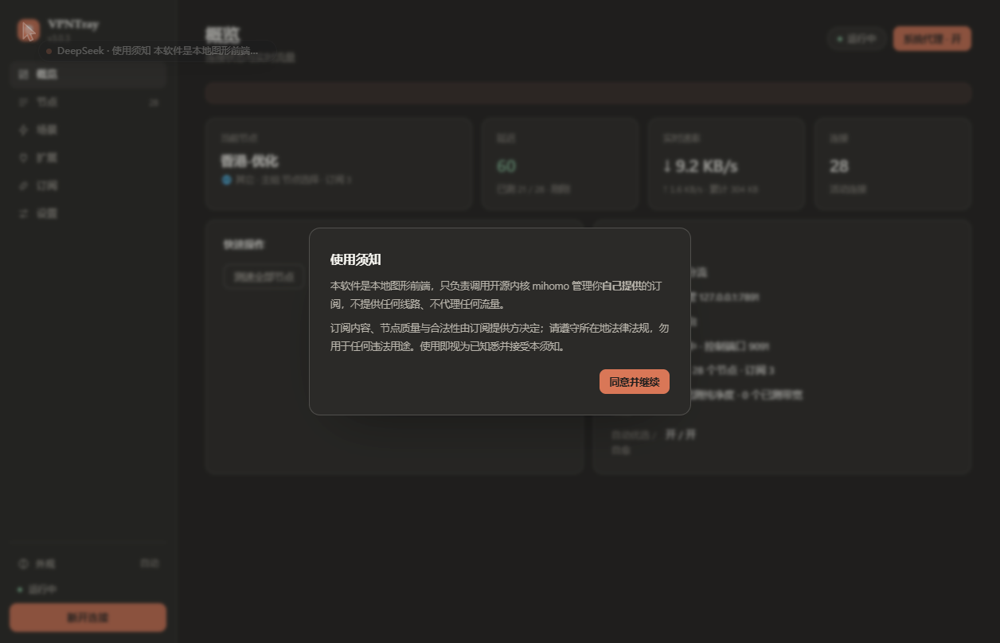
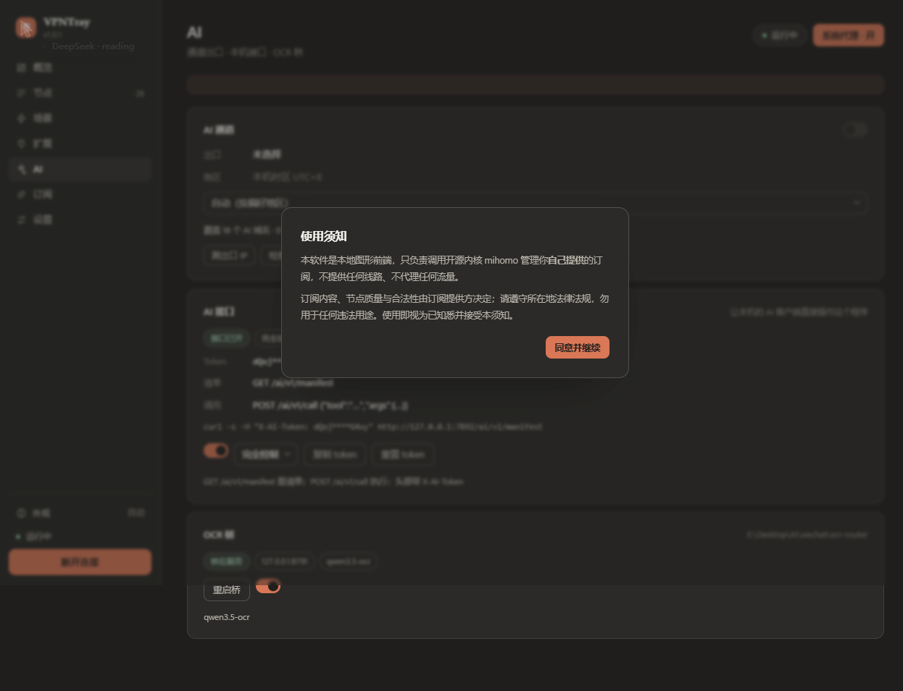
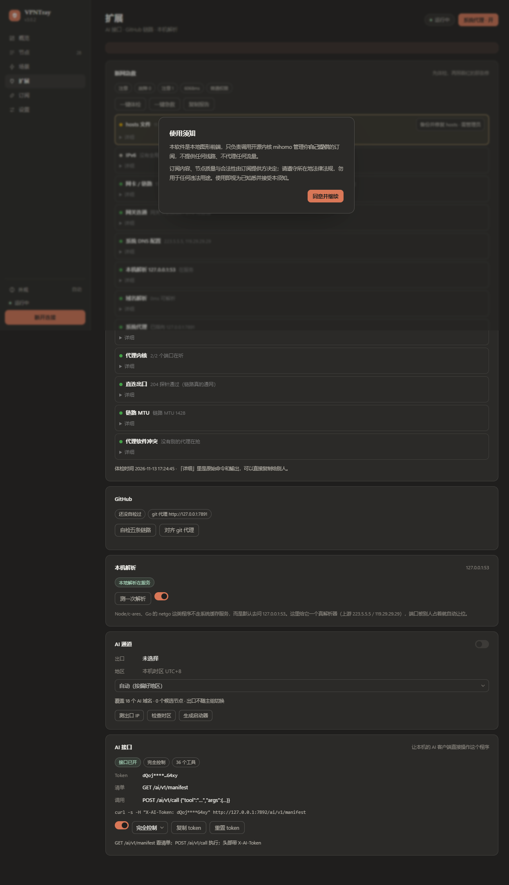
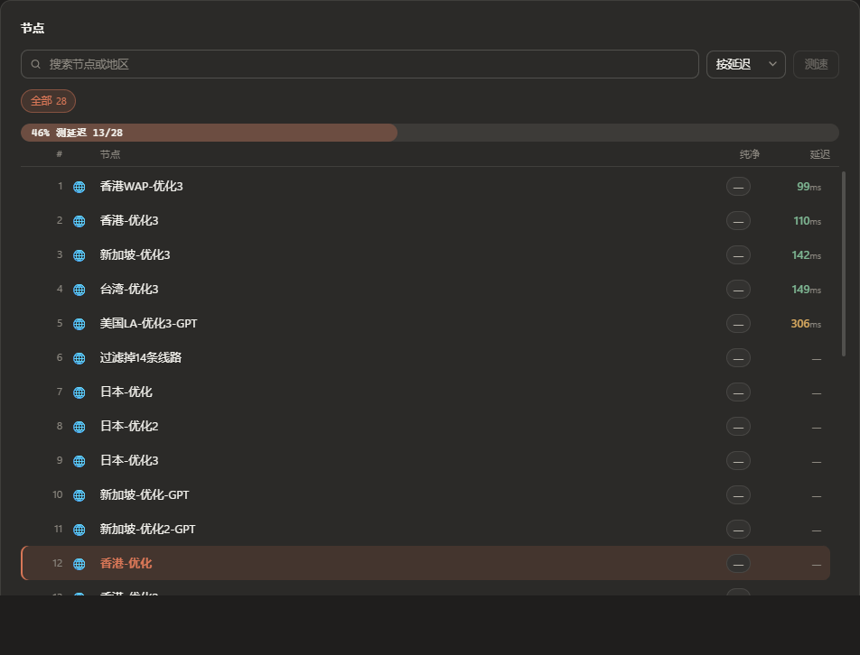

# VPN Tray

**[⬇ 下载最新版](https://github.com/ayuanjc/VPNTray/releases/latest)** · Windows 10/11 · 解压即用，不用装 Python

常驻托盘的**分流代理**：内嵌 [mihomo](https://github.com/MetaCubeX/mihomo) 内核，国外走机场、国内直连，
出口切换在本地网页控制台里点一下就完事。不需要管理员权限，不装驱动，不写系统目录。

```
解压 → 双击 VPNTray.exe → 托盘出现橙色盾牌
双击图标 / 右键「打开控制台」 → http://127.0.0.1:7892/
第一次用：同意协议 → 把订阅链接粘进「订阅」→ 添加
```



> **声明**：本软件是个人学习网络协议与分流技术的本地工具，**不提供任何代理服务、节点、线路或订阅**，
> 也不运营任何服务器。界面里出现的节点、流量、套餐信息全部来自使用者自行配置的第三方订阅，与作者无关。
> 请在遵守所在地法律法规及所用服务商条款的前提下使用，后果自负。

> 装了火绒 / 360 / 电脑管家？它们可能拦住本程序写系统代理（日志里 `重新接管系统代理失败: [WinError 5]`）。
> 放行一次即可，见 [9.1](#91-火绒--360--电脑管家-拦住系统代理)。

---

## 1. 它做了什么

| 环节 | 行为 |
|---|---|
| 订阅 | 多条订阅并存、一键切换（按剩余流量排序）；启动自动拉取，默认每 6 小时更新并热重载 |
| 套餐 | 从订阅里解析「剩余流量 / 到期时间」，左上角常驻显示，快用完变色 |
| 分流 | 内网直连 → 场景模块规则 → 订阅规则 → `GEOSITE,cn` / `GEOIP,CN` 直连 → 其余走代理 |
| 内核 | 托管 `bin/mihomo.exe`（v1.19.32），崩溃自动重启（退避，最多 6 次），孤儿内核自动清理 |
| 系统代理 | 接管 Windows 系统代理到 `127.0.0.1:7891`，退出时精确还原你原来的设置 |
| 选节点 | 先测延迟，再用两次真实 HTTPS 请求验证，只选真的能上网的那个 |
| 健康看护 | 每 45 秒探当前节点，连续失败自动换；每 20 秒检查系统代理有没有被别人改走 |
| 场景模块 | 「一组域名 + 一个出口」写成 `data/modules/*.json`，面板里可增删改，改完热重载 |
| 断网急救 | 13 项逐项体检 + 13 个就地修复动作 + 可复制的纯文本报告 |
| 交易通道监控 | 出口 IP / OKX REST 延迟 / 行情 WS / 交易域名是否被投毒，异常直接弹托盘通知 |
| 校园网自动登录 | 自动认门户（Dr.COM / 深澜 / ePortal / 通用表单 / 自定义），掉线自动重登，登完把系统代理接回来 |
| AI 页 | 独立一级界面：AI 通道 + AI 接口 + OCR 桥，一眼看到「AI 这条路通不通」 |
| AI 接口 | `/ai/v1` 双端点，40 个工具，三级权限，让 AI 直接读状态、改配置、跑动作 |
| OCR 桥 | 托盘内守护 `127.0.0.1:8791`：端口没人听就拉起，掉线自动补；阿里云 AI 端点规则直连 |

端口：混合代理 `7891`、内核 API `9091`、控制台 `7892`、本机 DNS `127.0.0.1:53`（可选），
全部只监听 `127.0.0.1`。特意避开常见客户端用的 `7890 / 7897`，可以和别的代理软件共存。

---

## 2. 五分钟上手

1. 解压到一个**不含中文和空格**的目录（例如 `D:\VPNTray`），双击 `VPNTray.exe`
2. 第一次启动会弹使用协议，点「我已阅读并同意」
3. 打开控制台 → 左栏「订阅」→ 粘贴订阅链接 → 「添加」
4. 回到「概览」，等右上角亮绿灯、显示延迟数字，就通了
5. 打不开网页？左栏「扩展」→「断网急救」→ 一键体检，哪一条红，那一行右边就有对应的修复按钮

---

## 3. 控制台

深色、窄边、一屏一件事。左侧栏分六页：概览 / 节点 / 场景 / 扩展 / 订阅 / 设置。
数据每 1.5 秒刷新一次，切换节点、测速这类耗时动作走后台队列，界面不卡。

### 3.1 概览

当前节点（旗标 + 名称 + 延迟 + 纯净度）、上下行实时速率、累计流量、活动连接数、
当前模式（规则 / 全局 / 直连）、以及四个开关：系统代理、开机自启、自动优选、节点自愈。
下面的流量曲线和日志（最近 200 行，可折叠）跟着刷新。

### 3.2 节点

每行 `序号 · 旗标 · 节点名 · 纯净度 · 延迟`，当前节点高亮，点任意一行即切换。

- **筛选**：顶部一排地区 chip（全部 / 香港 / 日本 / 美国 / 台湾 / 新加坡…，带节点数），
  点一下只看这个地区，再点「全部」取消
- **搜索**：按节点名、地区、`IEPL`、`家宽` 过滤；一旦输入自动回到「全部」，
  避免「选了日本又搜香港 = 一行都没有」
- **排序**：按延迟 / 按纯净度 / 按名称；筛选与排序记在 `localStorage`，下次打开还是原样
- **测速**：行内延迟数字可单点重测（<1 秒）

### 3.2.1 纯净度怎么算

先拿出口 IP 画像，再折算成 0–100 分。画像优先走 One-IP（`ip.net.coffee`），
它给综合信任分与判定标记；挂了回退 `ipapi.is`，再不行回退 `ip-api.com`，
当前用的哪一家显示在分数后面，例如 `纯净度 62（One-IP）· 一般`。

| 分数 | 等级 | 含义 |
|---|---|---|
| 85–100 | 极洁净 | 住宅 / ISP 原生 IP，ChatGPT、流媒体、银行风控都过 |
| 70–84 | 良好 | 能用，个别严格的站会拦 |
| 50–69 | 一般 | 机房 IP，流媒体多半不行，ChatGPT 常被拦 |
| < 50 | 较差 | 被标记的脏 IP，建议别用 |

回退算法的起评分 100：Tor 出口 −45、滥用标记 −40、机房 IP −30、代理标记 −28、
VPN 标记 −22、落地国家与节点标称不符 −18、爬虫库 −15、保留地址 −30。
结果缓存在 `data/purity.json`，24 小时内不重复测。

> 节点名对上就复用缓存，所以换订阅后同名节点秒出分数；名字不同则自动忽略，没有副作用。

### 3.3 场景 / 模块

一个**模块**就是「一组域名 + 一个出口」。内置两个（Steam、GitHub），
面板上「+ 新建」可以随便加，改完立即热重载，不用重启程序。

模块文件：`data/modules/<key>.json`，一个文件一个模块，`key` 就是文件名。

| 字段 | 说明 |
|---|---|
| `key` | 唯一标识，`^[a-z0-9][a-z0-9_-]{1,31}$`，重命名等于新建 |
| `title` | 显示名，也是策略组名，**模块之间不能重名** |
| `kind` | `scene`（建策略组）或 `rule`（只插规则，不建组） |
| `enabled` | 关掉 = 不建组也不插规则，规则直接落到后面的 CN 直连 / 代理 |
| `group` | `{type, auto, auto_title, probe, interval, timeout, target}`，`type` ∈ `select / fallback / url-test / load-balance` |
| `match` | `{domains[], rules[], cidrs[]}`；`domains` 走 `DOMAIN-SUFFIX`，`rules` 是原样规则，`cidrs` 带 `no-resolve` |
| `prefer_regions` | 建组时优先挑这些地区的节点 |
| `pinned` | 钉死的出口节点名；留空 = 交给策略组自己选 |
| `builtin` / `icon` / `order` | 内置标记、图标、排序 |

上限：64 个模块 / 每个 400 条域名 / 200 条规则。规则类型只允许白名单里的 18 种，
目标组由程序拼，不允许你在规则里写 `DIRECT` 之类的旁路——防止一条手写规则把整个分流打穿。

- `group.auto` 且 `kind=scene` 且可用节点 ≥2 时，额外建一个「XX 自动」子组（`url-test`，`tolerance=50`）
- 组名与订阅里的组重名时，本轮跳过该模块并在 `app.log` 记一条 WARNING（重名会让内核起不来）
- 内置模块只在首次运行物化一次（`data/modules/.seeded`）；删掉不会自己复活，
  想恢复就在面板点「恢复内置」，自建模块不受影响
- 模块增删改后：重写 `config.yaml` → 调内核热重载 → 恢复上次选择的出口

规则插入顺序（自上而下逐条匹配，命中即走）：

```
局域网直连 → AI 域名 → 各模块规则（按 order）→ CN 补充规则
→ 订阅规则 → GEOSITE,cn,DIRECT → GEOIP,CN,DIRECT → MATCH,主组
```

### 3.4 订阅

多条订阅并存，`single` 模式只用当前这条，`merge` 模式把所有订阅的节点合成一个池
（同一机场多个账号时用）。列表里显示剩余流量、到期时间、节点数、上次更新时间；
每 6 小时自动更新，也可以点「立即更新」。

### 3.5 扩展

零碎小件都收在这一页：

| 卡片 | 作用 |
|---|---|
| **断网急救** | 13 项体检 + 就地修复 + 报告复制，见 [第 4 章](#4-断网急救) |
| **GitHub 链路** | 五项链路自检（DNS / TCP / TLS / 响应 / 实际拉取），失败可自动把出口切到能连上的节点 |
| **本机解析** | 拉起 `127.0.0.1:53` 的本地 DNS 兜底，专门伺候 Node / c-ares 这类绕过系统代理的程序 |
| **校园网** | 认门户、存学号密码、掉线自动重登（1.0.0 新增），见 [3.5.1](#351-校园网) |

AI 那两块（AI 通道 / AI 接口）从 1.0.1 起搬到独立的一级页面，见 [3.5.2](#352-ai-页ai-通道--ai-接口--ocr-桥)。

#### 3.5.1 校园网

宿舍 / 教学楼的 Wi-Fi 通常要过一道门户认证，掉线后网页会被劫持到登录页。这一卡把它自动化：

1. 点「探测」——程序拿 `generate_204` 探针试一次，被劫持就看 `Location`，顺手把认证页地址回填到设置里，并把识别出的类型标在徽标上（Dr.COM / 深澜 / ePortal / 通用 / 自定义）。
2. 填学号和密码，打开右边的「自动重登」。
3. 之后每 30 秒（可在接口里调 15~600）看一眼：通了什么都不做；被劫持才登录；真断网不折腾。失败按 30/60/120/300 秒退避。
4. 登录成功后自动清 DNS 缓存、把系统代理接回来、网关变了就重启内核 —— 不用手动点「重启内核」。

认不出的门户（各校自研系统）用「自定义」：填认证页地址，模板里写 `{user}` `{pass}` `{ip}` `{mac}` `{portal}`，程序把你的值替换进去直接发请求。要验证码的门户只提示、不硬刷，避免把账号刷锁定。

配置存在 `settings.json`：`campus_enabled`、`campus_provider`、`campus_user`、`campus_pass`（DPAPI 封装）、`campus_portal`、`campus_template`、`campus_interval`、`campus_auto_open`。

#### 3.5.2 AI 页：AI 通道 / AI 接口 / OCR 桥

左栏「AI」是 1.0.1 新开的一级页面。以前这三块塞在「扩展」页最下面，出事的时候正好是最想看一眼的那三块，却要先滚到底。

| 卡片 | 看什么 |
|---|---|
| **AI 通道** | AI 专用出口组现在挂哪个节点、出口 IP 落在哪个国家、时区是否对齐、要不要拉启动器 |
| **AI 接口** | token（默认打码，点「复制」才显形）、权限级别（read / write / full）、40 个工具、接口地址 |
| **OCR 桥** | `127.0.0.1:8791` 在不在听、模型名、已转张数、认字成功/失败、缓存命中；「重启桥」= 按端口结束 node 再拉起；右边开关控制托盘内的守护 |



OCR 桥为什么归 VPNTray 管：把图片交给模型之前，DSH 会先送到本机 8791 换成文字。那个端口后面是一个 node 进程（`ocr-router/server.mjs`），它没在听的时候，模型调用直接 `ECONNREFUSED`，界面上看起来就是「模型不可用」或者一直转圈 —— 用户的第一反应永远是去重连节点。托盘程序本来就常驻，所以顺手把它看住：

- 探活走 `GET /health`（1 秒超时），**不用 TCP connect** —— 端口被别的程序占着时 connect 一样成功，那是最容易误判成「活着」的假象。
- 只拉起目录里**确实有 `server.mjs`** 的地方（`settings.ocr_bridge_dir` 可指定，默认 `E:\Desktop\AI\wechat\ocr-router`），不猜命令。
- 「重启桥」只杀**确实监听这个端口的 `node.exe`**；占用者是别的程序（比如你自己起的服务）时拒绝动手，并把进程名报出来。
- 退出 VPNTray **不杀 node**：OCR 桥和托盘生命周期解耦，重启托盘不该打断正在跑的识别任务。所以「关掉开关」也只是停自检，不杀进程。
- 这条链路与代理无关：`ocr-router` 模块把 `dashscope.aliyuncs.com` 等阿里云域名写死 `DIRECT`，**内核全挂的时候它照样能用**。

相关设置：`ocr_bridge`（默认 true）、`ocr_bridge_dir`、`ocr_bridge_port`（8791）、`ocr_bridge_interval`（30 秒）。HTTP 端点：`/api/ocr/status`、`/api/ocr/restart`、`/api/ocr/config`；状态在 `/api/state` 的 `state.ocr`。

### 3.6 设置

运行模式（规则 / 全局 / 直连）、开机自启、系统代理开关、日志级别、检查更新、
以及维护动作：纯净度（当前 / 全部）、带宽测速、重启内核、断开全部连接、扫描代理冲突、退出程序。
所有确认框都是页面内自绘弹窗（Enter 确定 / Esc 取消），不弹 Windows 原生对话框。

---

## 4. 断网急救

「网突然不能用了」在这一页变成可点的一屏。一轮体检 5～7 秒，跑在独立线程里，面板轮询不受影响。



### 4.1 13 项体检

| 项 | 看什么 |
|---|---|
| 网卡 / 链路 | 拿到哪个 IP、属于家用 / 校园 / NAT、有没有默认网关 |
| 网关连通 | ping 网关的丢包与延迟（判断是本地链路还是上游） |
| 系统 DNS 配置 | 指向谁、是静态还是 DHCP、有没有兜底 |
| 本机解析 53 | `127.0.0.1:53` 有没有人在解析，是否该开 |
| 域名解析 | 用系统 DNS 和公共 DNS 各问一次同一个域名，区分「本机 DNS 坏了」和「真的断网」 |
| 交易域名解析（反投毒） | 单独查 `www.okx.com` / `www.binance.com`：有效路径回了 `169.254.x.x` / `0.0.0.0` / `127.x`，或 CNAME 落到 `okpool.top`，就是 DNS 投毒；同时列出上游公共 DNS 的结果作对照：只有上游脏 → 绿（已被 policy 绕过），系统 DNS 脏但配置里有 policy → 黄（内核侧已走代理 DoH，不走代理的程序仍会中招，建议开本机解析） |
| 系统代理 | 指向 `127.0.0.1:7891` 但没人监听？还是被别的软件改了？ |
| 代理内核 | `7891 / 9091` 两个端口在不在听 |
| 直连出口 | 绕过代理打 204 探针：通、不通、还是被门户劫持 |
| 链路 MTU | `ping -f` 倒推 MTU，1428 是 PPPoE 的典型值；分片全丢也能看出来 |
| hosts 文件 | 几条屏蔽、几条重复、文件是不是被设成只读 |
| 代理软件冲突 | 别的 Clash / v2rayN / sing-box 在抢系统代理或 TUN |
| IPv6 | 有没有全局地址（没有不影响 IPv4 上网） |

每条都给**证据**而不是结论：具体 IP、具体毫秒、具体端口、具体文件名。

### 4.2 13 个修复动作

| 动作 | 做什么 | 管理员 |
|---|---|---|
| `flush_dns` | `ipconfig /flushdns` | 否 |
| `fix_proxy` | 清空系统代理并关掉「系统代理」意图 | 否 |
| `start_dns` | 拉起本机解析 `127.0.0.1:53` | 否 |
| `restart_kernel` | 重启 mihomo（连接会断一下） | 否 |
| `fix_dns` | 网卡 DNS 固定成公共 DNS | 是 |
| `fix_dns_keep_local` | 给现有 DNS 补一个公共兜底 | 是 |
| `dns_auto` | 网卡 DNS 改回自动获取 | 是 |
| `renew_ip` | `ipconfig /release` + `/renew` | 否 |
| `restart_adapter` | 禁用再启用默认网卡（断网约 3 秒） | 是 |
| `winsock_reset` | `netsh winsock reset` + `int ip reset`（要重启） | 是 |
| `fix_hosts` | 备份 → 删屏蔽条目 → 补回标准 localhost → 按域名去重 → `flushdns` | 是 |
| `open_portal` | 打开校园网 / 酒店认证页 | 否 |

`fix_hosts` 的具体规则：

- 只删「把域名指到 `0.0.0.0` / `127.0.0.1` / `::1` / `::`」的行，
  `127.0.0.1 localhost` 这种标准行留着
- 你自己写的正常映射（`10.0.0.9 nas.lan`）**一律不动**
- 同一域名出现多次只留第一条；注释和空行原样保留
- 先备份成 `hosts.vpntray-<时间戳>.bak`，同时留一份固定的 `hosts.vpntray.bak`
- 文件被破解补丁设成只读也能处理，写完自动 `flushdns`

**一键急救**只跑安全的四项：清缓存 → 清系统代理 → 拉起本机解析 → 重启内核。
要管理员权限的动作（改 DNS、重启网卡、Winsock、hosts）只列出来不硬干——
这个程序不会替你决定断网三秒。

单项修完会**就地复检**那一项，红的当场变绿，不用重跑整轮。

### 4.3 报告

点「复制」得到一份纯文本，坏的在最上面：

```
[BAD ] 系统代理：还挂着 127.0.0.1:7891，但没人监听
       ProxyEnable=1 ProxyServer=127.0.0.1:7891
       建议：清空系统代理（恢复直连）
[OK  ] 网关连通：网关 172.50.86.1 3ms 无丢包
[WARN] hosts 文件：3 条屏蔽（internetdownloadmanager.com, live.altium.com…）
       建议：备份并修复 hosts
```

### 4.4 命令与 AI 接口

| 端点 | 方法 | 作用 |
|---|---|---|
| `/api/net/diagnose` | POST | 跑一轮体检（`{"refresh":true}` 强制重跑） |
| `/api/net/repair` | POST | 一键急救（默认安全四项） |
| `/api/net/fix` | POST | 单项修复 `{"action":"fix_hosts"}` |
| `/api/net/report` | POST | 拿纯文本报告 |

AI 侧对应四个工具：`net.diagnose` / `net.report`（read）、`net.fix` / `net.repair`（full）。

---

## 5. AI 接口

程序对外只开两个端点，别的什么都不暴露：

```
GET  /ai/v1/manifest   → 版本、权限级别、工具清单与参数说明
POST /ai/v1/call       → {"tool":"modules.list","args":{}} → {"ok":true,...}
```

鉴权：token 在 `data/settings.json` 的 `ai_api_token`（首次启动生成 32 位），
三种传法任选 —— `X-AI-Token: <token>`、`Authorization: Bearer <token>`、`?token=<token>`。
面板「扩展 → AI 接口」里能看、能复制、能重置。

```bash
curl -s http://127.0.0.1:7892/ai/v1/manifest -H "X-AI-Token: $TOKEN" | jq .level
curl -s -X POST http://127.0.0.1:7892/ai/v1/call -H "X-AI-Token: $TOKEN" \
     -H 'Content-Type: application/json' \
     -d '{"tool":"net.repair","args":{}}'
```

三级权限（`settings.ai_api_level`）：

| 级别 | 能力 | 典型工具 |
|---|---|---|
| `read` | 只看不动 | `status` `modules.list` `nodes.list` `subs.list` `log.tail` `net.diagnose` |
| `write` | 改配置、切节点 | `modules.save` `modules.delete` `scene.select` `node.select` `mode.set` `sub.*` |
| `full` | 会断网 / 会退出的动作 | `kernel.restart` `proxy.system` `winsock` 类、`test.speed` `update.apply` `app.quit` |

40 个工具，分四组：状态与清单（read）、模块与出口（write）、内核与系统（full）、网络体检与校园网（read/write/full 混合）。
超权限调用返回 `{"ok":false,"error":"「重启内核」需要 full 权限，当前上限是 write","need":"full"}`，
不会半执行。`test.speed` / `test.purity` 是后台排队，立刻返回 `{"ok":true,"queued":true}`。

> 想彻底关掉：面板里关「AI 接口」，或者把 `ai_api_enabled` 设成 `false`，之后 `/ai/v1` 一律 401。

---

## 6. 托盘菜单

左键双击打开控制台；右键菜单从上到下：

- 状态（当前节点 · 延迟）、实时速率、当前订阅的账户信息
- **切换节点**（子菜单，按地区分组，当前节点打勾）
- 模式：规则分流 / 全局代理 / 全部直连
- 测延迟、自动优选、节点自愈、系统代理、开机自启、本机解析
- 打开控制面板、断开全部连接、重启内核、打开日志目录、退出

---

## 7. 目录结构

```
VPNTray/
├── VPNTray.exe            主程序（onedir）
├── _internal/             Python 运行时 + 打包进去的 assets（别删）
├── bin/
│   ├── mihomo.exe         内核
│   └── GeoIP.dat / GeoSite.dat / country.mmdb
├── data/                  运行时数据（删了会自动重建）
│   ├── config.yaml        由订阅 + 模块生成的配置
│   ├── settings.json      你的设置（含 AI token）
│   ├── modules/           场景 / 规则模块，一个文件一个模块
│   ├── subscriptions.json 订阅列表
│   ├── sub_cache.yaml     订阅原始备份
│   ├── purity.json        纯净度缓存
│   ├── sysproxy_backup.json  接管前的系统代理设置
│   ├── feedback/          生成的反馈包
│   ├── ui/                内核自带的 metacubexd 面板
│   └── logs/              app.log / kernel.log
└── 首次使用.txt / README.md
```

源码树里另有 `vpntray/`（Python 包）、`assets/`（控制台单文件前端 + 图标）、
`tools/`（自检与辅助脚本）、`tests/`（单元测试）。

---

## 8. 关键设置（`data/settings.json`）

| 键 | 默认 | 说明 |
|---|---|---|
| `sub_url` / `sub_active` | — / `0` | 老字段，迁移到 `subscriptions.json` 后只读 |
| `sub_mode` | `single` | `single` 只用当前订阅；`merge` 合并所有订阅的节点 |
| `sub_update_hours` | `6` | 订阅自动更新间隔，`0` = 关闭 |
| `mixed_port` / `controller_port` | `7891` / `9091` | 混合代理端口 / 内核 API 端口 |
| `system_proxy` | `true` | 启动后接管 Windows 系统代理 |
| `mode` | `rule` | `rule` / `global` / `direct` |
| `delay_interval_min` | `20` | 延迟刷新间隔，`0` = 关闭 |
| `auto_best` | `false` | 定时切到最快节点（会覆盖手动选择） |
| `heal` | `true` | 当前节点失效自动换 |
| `dns_guard` | `true` | 本机 DNS 兜底 `127.0.0.1:53` |
| `scene_auto` | `true` | 给带 `group.auto` 的场景建「XX 自动」子组 |
| `ai_api_enabled` | `true` | AI 接口总开关 |
| `ai_api_level` | `full` | AI 权限上限 `read` / `write` / `full` |
| `ai_api_token` | 自动生成 | AI 接口 token（32 位，重置会换新） |
| `auto_update` / `update_repo` | `true` / `ayuanjc/VPNTray` | 更新检查 |
| `ocr_bridge` | `true` | 托盘内守护 OCR 桥（端口没人听就拉起） |
| `ocr_bridge_port` / `ocr_bridge_dir` | `8791` / 空 | 桥的端口与目录（空 = 自动找 `server.mjs`） |
| `ocr_bridge_interval` | `30` | 自检间隔（秒，最小 10） |
| `campus_enabled` / `campus_provider` | `false` / `auto` | 校园网守护与门户类型 |
| `campus_interval` | `30` | 校园网探测间隔（15~600 秒） |

> `steam_*` / `github_*` 等场景键在 2.5.9 起废弃，只在首次把老配置迁移成
> `data/modules/*.json` 时读一次；之后一切以模块文件为准。

---

## 9. 常见问题

### 9.1 火绒 / 360 / 电脑管家 拦住系统代理

表现：控制台「系统代理」是关的、日志刷 `[WinError 5]`、浏览器仍然直连。

1. 安全软件 → 信任区 / 白名单 → 添加 `VPNTray.exe`
2. 还在拦就进「系统防护 → 自定义规则」，给 `HKCU\\Software\\Microsoft\\Windows\\CurrentVersion\\Internet Settings` 放行写入
3. 确认放行：控制台点一次「系统代理」开关，看日志是否出现 `系统代理已开启 -> 127.0.0.1:7891`
4. 已经断网了：进「扩展 → 断网急救」点「一键体检」，系统代理那一条会告诉你是「没人监听」还是「被改走」

### 9.2 网页全打不开，但托盘显示已连接

按顺序看「断网急救」三项：网关是否通 → 域名解析是否通 → 直连 204 是否通。
网关不通 = 本地链路问题；网关通但域名不通 = DNS 被改坏；都通但代理不通 = 内核或系统代理的问题。

### 9.3 日志里「订阅的 fake-ip-range 不是保留地址段」

这不是报错，是护栏。有些机场订阅写着 `fake-ip-range: 28.0.0.1/8`，
而 `28.0.0.0/8` 是真实公网段，拿它当虚拟 IP 池会让半个互联网解析异常。
程序只接受 `198.18.0.0/15` 和 `100.64.0.0/10`（前缀不宽于 /16），不合规就回退 `198.18.0.1/16` 并记 WARNING。
同类警告「订阅开启了 dns.ipv6，但本机没有 IPv6 出口，已关闭」同理，都不用管。

### 9.4 双击图标没反应 / 托盘里没有

看 `data/logs/app.log` 最后几行。常见两种：单文件版被杀软卡在解包，换 onedir 版；
或安全软件把进程挂起，加白名单后重启。

### 9.5 AI 面板全红 `cannot resolve` / `local name resolution failed`

Node / c-ares 不吃系统代理也不吃 hosts，只认系统 DNS。到「扩展 → 本机解析」打开兜底，
它就是 `127.0.0.1:53` 的本地解析服务。

### 9.6 Windows 拦了一句「Windows 已保护你的电脑」（SmartScreen）

这行提示不是杀毒软件的结论，是「这个 exe 没有数字签名、下载量还不够多」，Windows 拿不准，先拦一下。共三种处理方式，从省事到彻底：

1. **解压之前先解锁 zip**（推荐）：右键下载到的 zip → 属性 → 最下面勾「解除锁定」→ 确定 → 再解压。标记不会传给解压出来的文件，双击 exe 就不再弹。
2. **已经解压了**：双击包里的 `解除锁定.cmd`，它对本目录跑一遍 `Unblock-File -Recurse`，等价于对每个文件做第 1 步。
3. **点「更多信息」→「仍要运行」**：只对当前这个文件生效，下次换版本还会弹。

想确认文件没被人替换过，对着包里的 `SHA256SUMS.txt` 核一遍：

```powershell
Get-FileHash .\VPNTray.exe -Algorithm SHA256
Get-FileHash .\bin\mihomo.exe -Algorithm SHA256
```

彻底消掉这个提示只有一条路：买代码签名证书（OV 约千元/年，EV 一次性几千且要硬件令牌）并在 release.ps1 里加 `signtool sign`。没有证书时，程序自己能做的上限是「启动后把目录里所有文件的 Internet 标记清掉」（`ui_native.unblock_tree`），但那是拦完以后的事了。

### 9.7 同时开着别的代理软件

它们会抢同一套东西：系统代理注册表、PAC、TUN 虚拟网卡。控制台「扫描代理冲突」会列出
系统代理状态、其他代理进程、Up 状态的 TUN 网卡，然后三个按钮分别处理（每一步都弹确认）：

| 按钮 | 做什么 | 影响 |
|---|---|---|
| 关闭系统代理 | `ProxyEnable=0` 并删掉 `ProxyServer` / `AutoConfigURL` | 立刻走直连 |
| 结束冲突进程 | `taskkill` 列出来的进程 | 会关掉你别的代理软件 |
| 禁用 TUN 网卡 | `Disable-NetAdapter` | 需要管理员 |

自己的进程和 mihomo 永远排除在列表外；清系统代理时会把「系统代理」开关一起记成关闭，
否则健康看护 20 秒后又装回去。

---

## 10. 从源码运行 / 打包 / 测试

```powershell
python -m pip install pystray pillow pyyaml requests pywin32
python run.pyw                      # 直接从源码跑

pwsh -File build.ps1                # 单文件 exe（自己用；装了 GamePP 之类会崩的机器别用）
pwsh -File release.ps1              # onedir 发布包（给别人用，启动快、误报少）
python -m pytest tests -q           # 单元测试
```

- 版本号只有一个来源：`vpntray/webui.py` 的 `UI_VER`（`__init__.py` 与前端同步）
- `release.ps1` **必须用 PowerShell 7**（`pwsh`）跑：5.1 会把无 BOM 的 UTF-8 脚本按 ANSI 解析
- 产出 `release/VPNTray-<版本>-win64.zip`，不含任何订阅与你的设置，
  但带一份 `data/purity.json`（同名节点直接有分数）

启动参数：`--console` 启动后打开控制台、`--no-web` 不启控制台、`--pystray` 用备用托盘。

---

## 11. 更新日志

### 1.0.1 — AI 相关功能独立成页 + OCR 桥进出厂

**左栏多了「AI」**：AI 通道、AI 接口、OCR 桥搬到一起，成为一级页面。「扩展」页只剩断网急救、校园网、GitHub 链路、本机解析四件——都是「别的东西坏了」的时候才来的，不再和 AI 混在一起。

**OCR 桥卡片（新）**：`127.0.0.1:8791` 活着没有、模型名、已转张数、认字成功/失败、缓存命中，一眼看完。「重启桥」按端口找到真正在监听的 `node.exe` 结束再拉起——占用者不是 node（你自己起的服务）时拒绝动手并报进程名。右边开关控制托盘内守护：开了端口没人听就自动拉起，掉线自动补；关了只停自检，**不杀正在跑的 node**。

**`ocr-router` 变成出厂模块**：`OCR 桥 / 阿里云直连`，`kind: rule`，把 `dashscope.aliyuncs.com`、`aliyuncs.com`、`aliyun.com`、`aliyuncs.com.cn`、`aliyun-inc.com` 直连。换机器装完就有，不用手工建。

**播种逻辑改成「缺失即补」**：以前只有 `.seeded` 一个门闩，播过种的老机器永远不会拿到新增的出厂模块。现在多一份 `.seeded-keys` 清单——清单里没有的 key 才补，用户自己删掉的（清单里有）不复活。

**后端**：新增 `/api/ocr/status`、`/api/ocr/restart`、`/api/ocr/config`；`/api/state` 带 `state.ocr`；`ocrbridge` 新增 `kill(port)` / `restart(port)`（`netstat -ano` 找 LISTENING 的 PID，`tasklist` 确认是 node 才 `taskkill /F`）。

测试 257 例（新增 OCR 桥 15 例：端口反查、拒绝误杀、kill→start 顺序、真实 node 才动手、status 补 dir/pid、三条路由注册）。
### 1.0.0 — 版本号重编 + 校园网自动登录

**版本号从这里重编**：3.3.0 之后直接接 1.0.0。原因很直白 —— 一路上每次都是「再修一点」就加个次版本，数字越堆越高，跟成熟度已经没关系了。历史标签（v2.5.8 … v3.3.0）原样保留在 GitHub 上；从这一版起按新线走 1.x。检查更新遇到「远端标签比本机小」会多说一句原由，不会假装「已是最新」。

**新功能：校园网自动登录（扩展页 → 校园网）**

| 门户类型 | 怎么认 | 登录方式 |
| --- | --- | --- |
| Dr.COM | 地址或页面里有 `drcom`、城市热点 | `GET /drcom/login?user_account=,0,学号&user_password=…&wlan_user_ip=…` |
| 深澜 srun | `srun_portal`、深澜 | `POST /cgi-bin/srun_portal`，密码 `{BASE64}` 编码 |
| 华为 / H3C ePortal | `eportal`、`portal.do` | `GET /eportal/portal/login`，两种账号格式各试一次 |
| 通用表单 | 认不出就走这条 | 抓门户页第一个带 password 的 form，按字段名启发式填了提交 |
| 自定义 | 用户自己贴的地址 | 模板里的 `{user}` `{pass}` `{ip}` `{mac}` `{portal}` 会被替换 |

- 探测用 `http://connect.rom.miui.com/generate_204`：没认证时会被门户劫持，看 `Location` 就知道认证页在哪，不需要预先知道地址。
- 守护线程每 30 秒（夹在 15~600 之间）看一眼；只有「被门户劫持」才动手登录，真断网不动手（登也登不上）。失败退避 30 → 60 → 120 → 300 秒。
- 登录成功后三件收尾：清 DNS 缓存、把因为没认证而让路的系统代理接回来、网关变了就重启内核。
- 要验证码的门户会被识别成 `need_manual` 并停手，提示手动登录一次，不会每 30 秒刷一遍把账号刷锁定。
- 密码存 `settings.json` 的 `campus_pass`，写盘前 DPAPI 封装；日志里只出现账号，模板 URL 里的密码打码。

参数都在扩展页：认证方式下拉、学号、密码、认证页地址（可留空）、自定义模板、自动重登开关、间隔。AI 侧新增 `campus.status`（read）、`campus.login`（write）、`campus.config`（write）。

接口：`POST /api/campus/save`、`POST /api/campus/login`、`POST /api/campus/detect`；状态在 `/api/state` 的 `state.campus`。

测试 218 → 240 例（`tests/test_campus.py` 22 例：门户识别、表单解析、Dr.COM 报文、验证码分支、模板替换、守护退避、登录后收尾）。

### 3.3.0（旧编号）— 游戏平台全家桶：Xbox / 微软商店 + 八家启动器

之前只有 Steam 和 GitHub 两个场景，其它启动器全靠订阅自带的「微软服务」等组，
而那个组默认是 **DIRECT**（直连国内出口）。结果就是：微软商店能打开但下载和登录时好时坏，
Xbox App 登录卡住、云存档同步失败，Epic / EA / 育碧第一次登录转圈。

3.3.0 把「游戏平台」做成一等公民：每个平台一个模块、一个策略组、一条探测地址。

| 模块 | 覆盖 | 出口策略 | 探测 |
| --- | --- | --- | --- |
| Xbox 加速 | xboxlive / xboxab / xbox.com / Xbox 商店 mp.microsoft.com / dl.delivery 下载 / 微软账号登录 | 香港 → 日本 → 新加坡 → 台湾 → 美国 | xsts.auth.xboxlive.com |
| Epic 加速 | epicgames.com / 商店 CDN / 虚幻引擎 / EAC 反作弊 | 香港 → 日本 → 新加坡 → 台湾 → 韩国 | www.epicgames.com |
| 暴雪战网加速 | battle.net / blizzard.com / 国服 blzstatic.cn / 下载 CDN | 香港 → 台湾 → 日本 → 韩国 → 新加坡 | www.blizzard.com |
| EA 加速 | ea.com / origin.com / EA app / EAC 组件 | 香港 → 日本 → 新加坡 → 台湾 → 美国 | www.ea.com |
| 育碧加速 | ubisoft.com / Ubisoft Connect / ubi.com / uplay | 香港 → 日本 → 新加坡 → 台湾 → 欧洲 | www.ubisoft.com |
| GOG 加速 | gog.com / GOG Galaxy / gogcdn 下载 | 香港 → 日本 → 新加坡 → 台湾 → 欧洲 | www.gog.com |
| 拳头加速 | riotgames / riotcdn / LOL / 无畏契约 | 香港 → 台湾 → 日本 → 新加坡 → 韩国 | www.riotgames.com |
| Rockstar 加速 | Rockstar Launcher / GTA / 大镖客 / Social Club | 香港 → 日本 → 新加坡 → 美国 → 欧洲 | www.rockstargames.com |
| PlayStation 加速 | PS App / PSN 商店 / playstation.net | 香港 → 日本 → 台湾 → 新加坡 → 美国 | www.playstation.com |

几个细节：

- 每个组都自带「XX 自动」fallback 子组（interval 180s、timeout 3000ms），节点池里死了几个也不会整个平台打不开；想固定只用某个节点，在场景页的下拉里选一个就是钉死。
- 平台规则插在订阅规则**之前**，所以「微软服务 = DIRECT」不会再把这些域名抢走直连。
- Windows Update（windowsupdate.com）仍然直连，没有被卷进来 —— 系统更新走代理只会更慢。
- 出厂场景从 2 个增加到 11 个，只在首次运行（`data/modules/.seeded` 不存在时）物化；已经装过的用户不会被追加，需要的话用「新建模块」或重置内置模块。
- 新装用户第一次启动就有这 11 个模块，不用手写 JSON。

**Xbox 主机（同网段的实体机）还差一步**：主机不经过 PC 的 7891，只有 PC 开 TUN 并让主机把网关指向 PC 才吃得到代理。当前 TUN 需要管理员权限启动，非管理员启动时开关会提示「内核重启失败」。PC 上的 Xbox App / 微软商店不受这个限制。

测试：218 例（新增 `test_builtins_seed_once` 断言 11 个场景齐全且都能通过 validate）。

### 3.2.0 — 交易通道守护 + 兜底 DNS 不再转发投毒答案

修的是「代理通、直连死」这一类最难查的状态：2026-11-13 那次系统 DNS 把
www.okx.com 解成 CNAME awscn.okpool.top → 169.254.0.2（APIPA 黑洞），五个交易
进程全报 `Cannot connect to host www.okx.com:443`，而节点测速 120ms 全绿。

- **新增交易通道守护（okxguard）**：每 60 秒（`okx_guard_interval`）探四件事，
  异常直接发托盘通知，只在状态翻转时发一条，不刷屏：
  | 探什么 | 判定 | 为什么 |
  | --- | --- | --- |
  | 出口 IP | 与上次不同 | OKX API Key 绑了 IP 白名单，换 IP 会整片拒绝 |
  | REST 延迟 | 热连接 ≥ 800ms 或不通 | 挂单已过期、撤单赶不上 |
  | 行情 WS | `ws.okx.com:8443` 建连失败 | 盘口停在旧价，做市继续按死价报价 |
  | 交易域名解析 | 内核侧 / 系统侧分别查 | 唯一能提前发现「投毒复发」的信号 |
- **内核侧脏会自愈**：`/dns/query` 查出黑洞地址（169.254/16、0.0.0.0/8、127/8、
  198.18/15 等）时立刻 `log.error` + 请求 mihomo 重载配置；只有系统侧脏则只告警
  （现状如此：代理正常，直连会失败）。
- **兜底 DNS 不再转发投毒答案**：`127.0.0.1:53` 对 `okx.com` / `binance.com`
  改走「经代理的 DoH」（1.1.1.1 / 8.8.8.8，POST `application/dns-message`），
  取不到才退回国内上游（而且退回时如果上游给的是黑洞地址，直接回 SERVFAIL、
  不缓存 —— 宁可让客户端立刻重试，也不把 169.254.x.x 当答案发出去）。
  Node/c-ares、Go netgo 这类走本机 53 的程序（包括 okx_mm）因此拿到真地址。实测 `www.okx.com` 从 169.254.0.2 变成 104.18.43.174 / 172.64.144.82。
- **mihomo 活体检查**：以前看门狗只看 `poll()`，进程在但 API 不应答（配置把 DNS
  写死、监听队列打满、被系统挂起）时系统代理会一直指着死端口。现在连续 3 次
  （≈4.5 秒）`GET /version` 失败就按崩溃处理并走既有的自动重启流程。
- **AI 接口新增 `trade.status`**（read）：出口 IP、REST 延迟、WS、`dns_ok` /
  `dns_sys_ok` / `dns_bad`，工具总数 36 → 37；`/api/state` 多一个 `trade` 字段。
- **做市侧断路断言**：okx_mm 的 `setup()` 在缺 `HTTPS_PROXY/ALL_PROXY` 或代理端口
  连不上时直接退出（以前会静默直连黑洞地址，只在日志里刷 Cannot connect）。
- **同类告警不刷屏**：投毒告警与内核重载都按 10 分钟节流（以前 60 秒一条，
  一天 1440 行把 app.log 刷满，重载还会让全网每 60 秒抖一次）。
- **活体检查不误杀**：健康内核只记「活着」直接进下一轮（回归测试盯住这点，
  否则每个 tick 都会当成崩溃重启一次，2 秒一轮地把自愈次数打满）。
- 测试：`tests/test_trade_guard.py` 24 例（黑洞判定、报文解析、内核侧/系统侧分离、
  告警边沿、DoH 命中与回退、活体检查）；全量 214 例通过。

### 3.1.0 — 每个耗时任务都有真进度条

以前点了「测速全部节点」「纯净度 · 全部」「带宽测速」「下载并安装」，界面上只有一句
「正在执行：12 / 28」，或者干脆一条不动的细线，看着像卡死。现在这几个动作都在
**按钮下面**直接给出进度条 + 百分比 + 当前在测哪个节点，轮询也会自动提速到 700ms 一轮。

- 延迟测速改成逐节点并发测（12 路），每完成一个节点报一次进度：不是假动画，数据是真的；
  节点列表为空（刚启动还没拉到订阅）时才退回内核一次性测整组，那时只显示阶段文字。
- 纯净度 / 带宽测速：进度条下面写「检测 17/28 · 香港WAP-优化2」，百分比来自真实计数。
- 更新：按字节算的百分比，同时显示 `下载安装包 · 12.4 / 66.8 MB`，下载转校验/解压时阶段名会变。
- 跑完停在 100% 一秒再收起，不会一闪就没；同一件事在概览页和节点页各有一条，一起动。
- 有任务在跑时轮询 700ms 一轮（空闲仍 1800ms，连续失败仍按 2→30s 退避），设置页也能实时看到更新进度。
- 测试从 193 例加到 194 例（新增进度条接线断言：五条进度条、renderProgs、700ms 提速、百分比文字）。




### 3.0.3 — 交易域名被 DNS 投毒（okx 打不开，但别的网站都正常）

2026-11-13 的事故：五路交易进程同时报 `Cannot connect to host www.okx.com:443 ssl:default [None]`，
`curl -x 127.0.0.1:7891 https://www.okx.com` 返回 000，而百度、谷歌、GitHub 都正常、
mihomo 对 `www.okx.com` 的延迟测试还是 122~144ms 全绿。

查下来是两层原因叠在一起：

1. **国内 DNS 投毒**：`www.okx.com` / `app.okx.com` 被解析成 `CNAME awscn.okpool.top` →
   `169.254.0.2`（APIPA 链路本地段，永远没有服务器）。`okx.com` 和 `ws.okx.com` 拿到的是真地址，
   所以「同一个网站的某些子域能连、某些不能」。
2. **sniffer.force-dns-mapping=true** 要求先本地解析再连接：解析结果是黑洞地址，于是连一个
   不存在的 IP，TLS 拿不到 ServerHello —— 报错看起来像证书/SSL 问题，其实是地址是假的。
   节点延迟测试走节点侧解析，所以永远测不出来。

修法是把 `nameserver-policy` 做进生成器（以前只手工写进 `data/config.yaml`，
一重启内核 / 刷新订阅 / 切节点就丢）：

- `configgen.trade_dns_policy()`：`+.okx.com`、`+.binance.com` 的查询用
  `https://1.1.1.1/dns-query#节点选择` + `https://8.8.8.8/dns-query#节点选择`，
  即**查询本身经代理走 DoH**，本地网络看不到、也投不了毒。
- 订阅下发的 `nameserver-policy` 仍然丢弃（境外 DoH 直连会卡 5 秒），只保留交易域名这一份。
- 主组名为空（还没选节点）时不写 policy，避免写出空 `#` 目标。

同时新增体检第 6 项 **交易域名解析（反投毒）**：分别用有效路径（系统 DNS，指向 127.0.0.1 时
就是本机解析）和上游公共 DNS 各问一次，黑洞段 / `okpool.top` CNAME / `157.240.0.0/16`
都是判据；有效路径脏 → 红并建议清缓存，只有上游脏 → 绿并注明「已被 policy 绕过」。

顺带修掉一个更容易踩的坑：**测速全绿不等于能上网**。节点侧解析成功只说明节点能出网，
本地拿到假地址照样连不上；判断「只有某个境外域名不通」时直接看第 6 项。

体检项的结论分三档，避免「明明走代理能用却报红」：

- 系统 DNS 回黑洞地址、配置里也没有 policy → **红**（bad），建议清缓存；
- 系统 DNS 回黑洞地址、但 `data/config.yaml` 里有交易域名 policy → **黄**（warn），
  说明「内核侧已改走代理 DoH，走代理的程序没事，不走代理的仍会中招」，
  修复按钮变成「开启本机解析」；
- 只有上游公共 DNS 脏、本机解析干净 → **绿**，注明已被 policy 绕过。

测试 180 → 193 例（新增 `tests/test_dns_poison.py` 13 例：policy 形状、订阅 policy 被丢弃、
生成结果带 policy、黑洞段/CNAME 指纹判定、有效路径 vs 上游两种结论、policy 在时降级为 warn、
失败降级 skip、体检项顺序）。

### 3.0.2 — 全量审查后的加固版（无新功能，只修坑）

对着 16k 行代码做了一遍逐文件审查 + 五个并行代理复核，修掉 7 条会导致功能不可用的缺陷和
约 30 条隐患，全部有测试兜底（pytest 176 例）：

- **TUN 一直开不起来**：restart_kernel() 以前返回 None，set_tun() 里 ok = restart_kernel() 恒假，每次都被判成失败并回滚。现在只有端口真的起来才返回 True，抢不到工作锁单独用 state["kernel_skip"] 标出（不再冒充失败）。
- **非 select 模块规则全丢**：configgen 以前按 type=="select" 重算场景开关，url-test / fallback / load-balance 模块的域名规则一条都不插。现在用 _scene_groups() 的真实结果。
- **断网急救的 DNS 修复 100% 失败**：解析 netsh interface show interface 的正则按「接口 + 网卡名」两列写，实际输出是四列（Enabled Connected Dedicated WLAN），永远匹配不到网卡名。改成按词解析，中英输出都认，Get-NetAdapter 优先、netsh 兜底。
- **hosts 修复会污染文件**：以前 open(path, "w") 截断重写、一律按 UTF-8 读，GBK 的 hosts 会被写坏。现在先探测编码（utf-8-sig → utf-8 → gbk，全失败只报告不写回）、原子写（tmp + fsync + os.replace）、保留原权限位。
- **系统代理备份被自己覆盖**：netguard.wipe_system_proxy() 以前拿一份空备份覆盖用户的原始代理设置，清一次就永久丢失。现在只走 sysproxy.freeze_backup()；sysproxy.enable() 备份写失败直接抛错、不接管。
- **存储型 XSS**：节点名来自订阅（第三方可控），概览卡片拼接时没转义就进 innerHTML。现在全部走 esc()。
- **更新包校验**：非 API 路径以前 zip_sha256 恒为空且「无哈希就跳过校验」。现在按 <zip>.sha256 → SHA256SUMS.txt → API digest 的顺序找哈希，拿不到就拒绝自动安装（人工确认后可用「仍然安装」放行），下载后再校验一次；版本比较逐段数字（3.0.10 > 3.0.9），解压前卡总字节与单文件大小。
- **凭据加密**：settings.json 里的 controller secret 与 AI 接口 token 现在用 DPAPI 封装（前缀 dpapi:v1:，只有当前 Windows 账户解得开），文件权限收到仅当前用户（icacls）。
- **配置坏了不再全丢**：settings.json 整体解析失败时逐键抢救，能救回的订阅地址/节点选择继续用；字段类型不对先备份 settings.json.bad-<时间戳> 再回落默认值；旧的 steam_*/github_* 在模块物化后按 schema_version 清理。
- **并发与卡死**：AI 面板轮询失败会永久停更（旗标在 await 前就置位）已修，加了 12/30 秒超时、退避到 30 秒、切回标签页立刻刷新；托盘「重启内核」连点两次不再起两条线程；state["busy"] 不再当任务锁用（改用 _work_try / _work_done）。
- **界面与接口**：响应头补 X-Frame-Options / nosniff / Referrer-Policy / CSP；AI token 在 /api/state 里默认掩码，点「显示」才回传；断网急救可以异步跑（POST /api/net/diagnose/start），不再让转圈卡 6 秒。
- **数据目录不可写**：装到 Program Files 这类受保护目录时，data/ 自动退到 %LOCALAPPDATA%\\VPNTray\\data，状态里带 data_dir_fallback 供界面提示。
- 订阅层：base64 / URL-safe / GBK / BOM 订阅都能解；YAML 别名炸弹有上限；空 proxies、悬空策略组自动修复；缓存写失败不再谎报成功。
- 测速纯度：One-IP 探测走本地代理，不再有环境变量能把它指到别的站点。

### 3.0.1 — 检查更新说「未配置 update_repo」已修

- 更新仓库填错/留空不再是一句干巴巴的报错：`updater.normalize_repo()` 会把 `https://github.com/owner/name`、`owner/name/`、`owner/name.git`、`owner/name/releases/...`、前后空格统一收敛成 `owner/name`，非法字符或只填一半才报错，并说清该写什么。
- 概览页「检查更新」失败时直接给输入框 + 「保存并重查」：填完立刻写盘并重查，不用重启程序（`POST /api/update/repo`，参数 `{"repo":"owner/name"}`）。
- 设置页说明改成：仓库写成 `owner/name`，**留空 = 关闭检查更新**（以前这句只在代码注释里）。
- 测试从 62 增到 73：`tests/test_update.py` 覆盖 URL / 斜杠 / .git / 多级路径 / 非法字符 / 空值 / 保存后自动重查；`tests/test_single_instance.py` 覆盖互斥体判活与进程枚举。
- **顺手修掉的单实例竞态**：以前「杀掉旧进程 → 立刻双击新 exe」会起两个主实例（新实例看到端口全关，把正在启动的旧实例当成空壳直接接管），两套内核抢 7891，系统代理指谁看运气。现在 `run.pyw` 的接管分支先枚举 `VPNTray.exe` 进程：对方还活着就等它（最多 10 秒），只在自己独占时才启动。实测「并发双击两次」只留 1 个主进程 + 1 个窗口子进程。

## 3.0.0 断网急救 + 场景模块化收口

- **断网急救**：12 项体检、13 个修复动作、就地复检、报告可复制；四个 HTTP 端点 + 四个 AI 工具
- **hosts 修复**：备份 → 只删屏蔽行 → 补回标准 localhost → 按域名去重 → flushdns；
  `127.0.0.1 localhost` 不再被误判成屏蔽，自定义映射不动
- **动效**：切页左右滑动、卡片依次浮起、按钮按下回弹、开关弹跳、弹层缩放进入、
  长任务按钮转圈；全部只动 `transform/opacity`，并尊重 `prefers-reduced-motion`
- 修复「复制」在非 https 页面上静默失败（`navigator.clipboard` 不可用时退回 `execCommand`）
- 单元测试 62 个全绿

### 2.5.9 场景变成模块，AI 能直接操作它

- 场景从代码常量搬成 `data/modules/*.json`，面板可增删改，热重载
- `kind=rule` 支持「只插规则不建组」；组名冲突自动跳过并记日志
- `/ai/v1` 双端点、三级权限、token 鉴权，36 个工具

### 2.5.8 fake-ip 护栏

机场把 `fake-ip-range` 设成 `28.0.0.1/8` 时强制回退 `198.18.0.1/16`；
无 IPv6 出口时强制 `dns.ipv6=false`。

### 2.5.7 本机 DNS 兜底

新增 `127.0.0.1:53` 本地解析，救 Node / c-ares 的 `cannot resolve`。

### 2.5.6 修「点了没反应」

排除 setuptools / pkg_resources，避免 WMI 卡死时进程永久阻塞。

### 2.5.4 面板重写

侧栏分页、一屏一件事、自绘确认框，不再弹原生对话框。

### 2.5.0 GitHub 自动组 + 自检

五项链路自检、失败自动切出口、启动时对齐 git 的 http(s).proxy。

更早的版本（2.4 之前的拓扑图、地图、界面演化）见 git 历史。

---

## 12. 反馈与免责

「扩展」页里的反馈入口会收集版本、系统、节点数、订阅条数、当前节点和最近 200 行日志，
生成一份 markdown 存到 `data/feedback/` 并给出一条预填好的 GitHub issue 链接。

**日志在生成时已经脱敏**：订阅链接只留域名，节点 password / uuid 打码，
IPv4 留前两段、IPv6 留第一段，用户目录替换成 `%USERPROFILE%`。发之前自己先看一遍。

- 仓库：<https://github.com/ayuanjc/VPNTray>
- 问题：<https://github.com/ayuanjc/VPNTray/issues>

首次启动会弹使用协议（这是什么 / 你要负责的事 / 数据在哪里 / 免责 / 不同意怎么办），
必须点同意才能继续，同意状态按版本记录，升级后重新提示一次。

本软件不提供任何代理服务与订阅内容；使用者自行承担配置与使用带来的一切后果。
