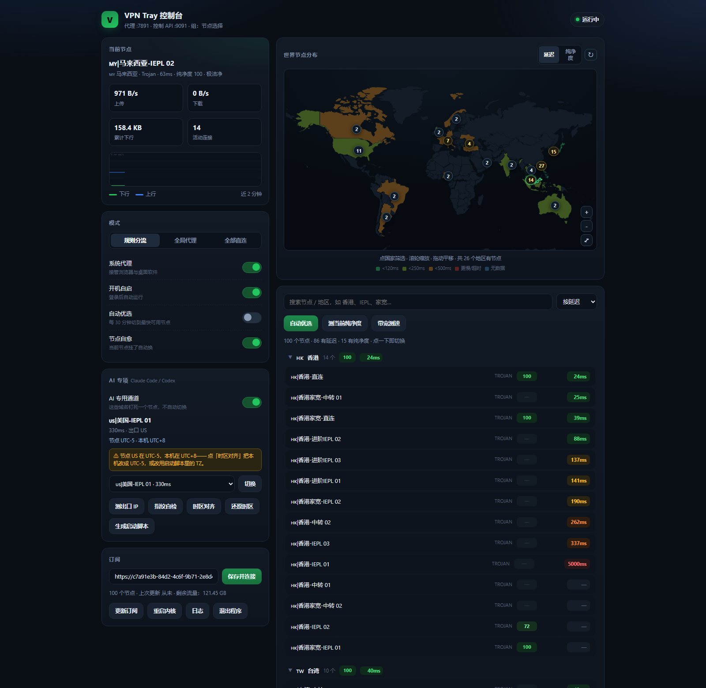

# VPN Tray — 常驻分流代理 + 本地控制台

**[⬇ 下载最新版](https://github.com/ayuanjc/VPNTray/releases/latest)** · 解压即用，不用装 Python

Windows 托盘工具：内嵌 [mihomo](https://github.com/MetaCubeX/mihomo) 内核，一直挂着访问国外网站，
国内网站保持直连。节点切换走**本地网页控制台**（也可以从托盘菜单切）。
不需要管理员权限，不装驱动。

```
解压后双击 VPNTray.exe  →  托盘出现绿色 V
双击图标 / 右键「打开控制台」→ http://127.0.0.1:7892/
第一次用：先同意使用协议，再把订阅链接粘到「订阅」卡里，点「添加」
```



> **声明**：本软件为个人学习与研究网络协议、代理与分流技术的本地工具，**不提供任何代理服务、节点、线路或订阅内容**，
> 亦不运营任何服务器。界面中出现的全部节点与流量信息均来自使用者自行配置的第三方订阅，与作者无关。
> 请在遵守所在地法律法规及所使用服务商条款的前提下使用；因使用本软件产生的一切后果由使用者自行承担。
> 详见页面底部的完整免责声明。

> **装火绒 / 360 / 电脑管家？** 它们可能拦住本程序写系统代理，表现为控制台里「系统代理」是关的、
> 日志里反复出现 `重新接管系统代理失败: [WinError 5]`，浏览器也还是直连。
> 放行一次就好：见 [6.1 火绒 / 360 / 电脑管家 拦住系统代理怎么办](#61-火绒--360--电脑管家-拦住系统代理怎么办)。

---

## 1. 它做了什么

| 环节 | 行为 |
|---|---|
| 订阅 | 首次运行在控制台填订阅链接；支持**多条订阅并存、一键切换**（按剩余流量排序）；之后启动自动拉取，默认每 6 小时更新并热重载 |
| 套餐 | 从订阅里解析「剩余流量 / 套餐到期」，左上角常驻显示，快用完/快到期变色 |
| 分流 | 内网直连 → 你的机场规则 → `GEOSITE,cn` / `GEOIP,CN` 直连 → 其余全部走代理 |
| 内核 | 托管 `bin/mihomo.exe`（v1.19.32），崩溃自动重启（退避，最多 6 次）；上次异常退出留下的孤儿内核会被自动清掉 |
| 系统代理 | 接管 Windows 系统代理到 `127.0.0.1:7891`，退出时精确还原你原来的设置 |
| 节点选择 | 每个节点先测延迟、**再用两次真实 HTTPS 请求验证**，只选中确实能上网的那个 |
| 健康看护 | 每 45 秒探一次当前节点，连续失败自动换（可关）；每 20 秒检查系统代理有没有被别的软件改走 |
| 测速 | 定时刷新全部节点延迟，控制台里直接看到 `38ms` / `超时` |

端口：混合代理 `7891`、内核 API `9091`、控制台 `7892`，全部只监听 `127.0.0.1`。
特意避开常见客户端用的 `7890 / 7897`，可以和别的代理软件共存。

## 2. 控制台（主界面）

`http://127.0.0.1:7892/` — 双击托盘图标，或托盘右键「打开控制台」。

- **当前节点 + 实时流量**：上下行速率、累计流量、活动连接数、近 2 分钟折线图
- **节点列表**：按地区分组（香港/日本/美国/台湾/新加坡…），延迟彩色分级，点一下即切换；
  顶部搜索框支持按地区名、`IEPL`、`家宽` 等关键词过滤
- **模式**：规则分流 / 全局代理 / 全部直连
- **开关**：系统代理、开机自启、自动优选、节点自愈
- **运维**：更新订阅、重启内核、查看日志、退出程序

数据每 1.5 秒刷新一次，切换节点 / 测速这些耗时动作用异步队列执行，界面不会卡。

## 3. IP 纯净度与排序

机场节点的「干净程度」直接决定 ChatGPT / 流媒体 / 银行风控能不能过。控制台可以逐个测：

| 入口 | 做什么 | 耗时 |
|---|---|---|
| 列表「测当前纯净度」 | 只测当前节点的出口 IP 画像 | 2 秒 |
| **地图右上角 ↻（纯净度模式）** | 逐个切过去重测所有节点，结束后自动回到原节点，**带进度条** | 2–4 分钟 |
| 列表「带宽测速」 | 对延迟最好的 10 个节点各下载 5MB 真实测速 | 1–2 分钟 / 约 50MB |

**地图右上角那个 ↻ 按钮跟着模式走**：
- 切到「延迟」→ 点它 = 重测全部节点延迟，地图颜色立即刷新
- 切到「纯净度」→ 点它 = 重新检测全部节点纯净度（带进度条）

检测过程中按钮会转圈并禁用，地图下方显示 `纯净度检测 37/74 · 50%` 的进度条。

**纯净度 0–100 怎么算的**

分两步：先拿到出口 IP 画像，再折算成分数。

1. **画像来源**：优先走 [One-IP](https://github.com/zhihui-hu/one-ip)（数据源 `ip.net.coffee`）。
   它给的是**综合信任分 + 判定标记**，比自己拿几个标志位扣分准得多。它挂了才回退
   `ipapi.is`，再不行回退 `ip-api.com`。当前用的哪一家会显示在分数后面，
   比如 `纯净度 62（One-IP）· 一般`。
2. **折算**：One-IP 给 `trust_score` 就直接当分数用，只在发现**落地国家 ≠ 节点标称**时
   再按本条扣分（这是 One-IP 看不到、但实际最影响使用的一点）。回退到 ipapi.is / ip-api
   时用下面的老算法。

从 One-IP 额外拿到了这些原本没有的信息，会显示在标签里：

| 字段 | 用途 |
|---|---|
| `trust_score` | 0–100 综合信任分，直接当纯净度 |
| `is_residential` / `company_type` | 判断住宅还是机房，比只看 `is_datacenter` 细 |
| `is_datacenter` / `is_vpn` / `is_proxy` / `is_tor` / `is_abuser` | 五类风险标记，命中就进标签 |
| `ai_verdict` | 该 IP 访问 AI 服务（ChatGPT/Claude 等）会被怎么对待 |
| `reddit_blocked` | 是否已被 Reddit 拉黑（风控严的站点会参考） |

回退到 ipapi.is / ip-api 时的老算法：

```
起评 100 分
  −45  Tor 出口          −40  被标记滥用        −30  机房 IP（AWS/阿里云等）
  −28  代理标记           −22  VPN 标记          −18  落地国家 ≠ 节点标称
  −15  爬虫库             −30  保留地址
```

| 分数 | 等级 | 含义 |
|---|---|---|
| 85–100 | 极洁净 | 住宅/ISP 原生 IP，ChatGPT、Netflix、银行都通 |
| 70–84 | 良好 | 能用，个别风控严格的站可能拦 |
| 50–69 | 一般 | 机房 IP，流媒体多半不行，ChatGPT 常被拦 |
| < 50 | 较差 | 被标记的脏 IP，建议别用 |

结果缓存在 `data/purity.json`，24 小时内不重复测。

**排序**：右上角下拉框可切换「按延迟 / 按纯净度 / 按带宽 / 按名称」，
地区分组也会跟着重排（纯净度排序时，最干净的地区排最前面）。
鼠标悬停节点能看到完整信息：等级、标签、出口 IP。

### 世界节点地图

地图和节点列表在同一栏（地图在上、列表在下）：

- **点地图上的国家 → 右侧立刻只剩该国的节点**，地图同时自动放大到该区域；
  再点一次取消筛选并回到全球视角
- **缩放**：滚轮缩放（最大 20 倍）、按住拖拽平移、双击放大、右下角 `＋ － ⤢` 三个按钮
- **纯 SVG 矢量绘制**：国家轮廓是 path 数据，放大多少倍边缘都是锐利的，不会糊
- 国家密集的地方（香港/台湾/日本/韩国挤在一起）会自动**聚成一簇**，
  数字是这一簇的节点总数，点开弹出国家清单，选中哪个就筛哪个；
  **放大后聚簇会自动散开**（阈值按屏幕像素换算）
- 地图右上角可以在「延迟 / 纯净度」两种上色之间切换，下方有颜色图例
- 当前节点所在的国家有绿色描边，正在筛选的国家高亮
- 地图筛选和搜索框是**叠加**的：筛了日本再搜 `IEPL`，就只显示日本 IEPL 节点
- 筛选状态记在浏览器里，下次打开还在

### 每个国家有自己的放大图

点任何一个有节点的国家/地区，地图会切成**这个国家自己的地图**：

- 所有 26 个有节点的国家地区都单独出图（🇭🇰香港 🇯🇵日本 🇺🇸美国 🇹🇼台湾 🇸🇬新加坡…
  🇰🇷韩国 🇻🇳越南 🇩🇪德国 🇬🇧英国 🇫🇷法国 🇮🇹意大利 🇳🇴挪威 🇨🇦加拿大 🇦🇺澳大利亚
  🇺🇦乌克兰 🇹🇷土耳其 🇦🇪阿联酋 🇳🇬尼日利亚 🇵🇭菲律宾 🇹🇭泰国 🇲🇾马来西亚
  🇮🇳印度 🇮🇩印尼 🇦🇷阿根廷 🇧🇷巴西 🇲🇴澳门）；
  地图卡会自动按这个国家的长宽比拉伸，不会缩在中间一小块
- **节点按编号落在地图上**：数字和右侧列表的序号一一对应，点编号直接切到那个节点；
  落点是节点**真实的出口 IP 位置**（不是机房城市），所以有时会落在国土外一点点，
  提示行会写明「N 个按 IP 真实位置 · M 个落地在境外」
- 港澳用**区级边界**（香港 18 区、澳门 8 堂区），其它国家用 Natural Earth 10m 国界轮廓，
  都是纯矢量，放多大都不糊
- 左上角「← 返回世界地图」退回全球视角并取消筛选
- 数据由 `tools/build_local.py` 生成到 `assets/local_map.js`（335KB / 26 个）

### 链路拓扑（第二张地图）

地图卡右上角有「节点分布 / 链路拓扑」两个页签，切到**链路拓扑**就是一张**没有颜色的底图**，
专门画你现在这条链路：

```
用户端（绿）——→ 代理入口（黄）——→ 落地出口（蓝）
   本机公网 IP      机场的入口机         真正对网站现身的 IP
   （直连查询）    （订阅里的 server）     （通过代理查到的 exit IP）
```

- 三个点自动定位经纬度，用**弧线连起来**，线上有流动的虚线和沿线跑的光点
- 进页面/切节点时自动取，换节点会立刻重算；右上角 `↻` 手动重取
- 视野会自动收到链路范围里，三个点不会挤成一团；标签自动左右避让、上下错开；点悬停看 ISP 详情
- 坐标查询走 ip-api.com，带 15 分钟缓存；「用户端」是**绕过系统代理直连**查的，
  所以它显示的是你家宽的真实出口，不是代理出口

**还没测过出口 IP 的时候**，第三条线不会空着，而是按下面两级退：

| 情况 | 第三个点画到哪 | 线型 | 标签 |
|---|---|---|---|
| 实测过出口 IP | 真正的落地城市 | 实线流动 | 落地出口 |
| 有节点 IP 但没坐标 | 节点 IP 的归属城市 | **虚线** | 节点 IP 位置 |
| 完全没测过 | 节点服务器所在机房 | **虚线** | 节点服务器 |

虚线就是「这个位置是推断的」，下方的黄色提示会写明怎么变成实测（点节点列表的
「测当前纯净度」，或 AI 卡的「测出口 IP」）。

## 3.4 订阅管理

左上角标题旁边一直显示当前订阅的**剩余流量和到期时间**（从机场订阅里那两条
「剩余流量：xxx」「套餐到期：xxx」的假节点解析出来，不联网也能显示）。

左栏底部的「订阅」卡可以存**多条订阅链接**：

- 每条显示：备注名、剩余流量（`<20G` 转黄、`<5G` 转红）、剩余天数（`≤7` 天转黄）、
  节点数、是否使用中
- **按剩余流量从多到少自动排序**，正在用的那条置顶并高亮
- 点「切换」立刻切到那条订阅（重新拉配置、重建节点列表，当前节点选择会重置到最快可用）
- 点「删」移除；下面一行是「备注名 + 链接 + 添加」

订阅列表存在 `data/settings.json` 的 `subs`，当前用哪条记在 `sub_active`。
老版本的单个 `sub_url` 会在第一次启动时自动迁移成第一条订阅。

### 合并模式（同一机场的多个账号）

同一个机场经常给你好几个订阅链接（不同账号、不同套餐）。它们的**节点名是一模一样的**，
只是账号不同。点订阅卡标题右侧的「合并」按钮就进入合并模式：

```
顶上：合并 6 条 · 总剩余 569.0 GB · 6 条可用
       ↑ 所有账号的余额加在一起，一眼看到还能用多久

跑着跑着：
  订阅 3 余额 248 GB  → 用到 0.3 GB 以下
  ↓ 自动（不用你动手）
  订阅 1 余额 120 GB  → 接着跑，节点名不变
```

它做三件事：

1. **余额汇总**：每条订阅都读订阅响应头里的 `subscription-userinfo`（`upload/download/total/expire`），
   拿到的是机场后台真实的已用/总流量，比解析「剩余流量：xxx」这类假节点名准。
   启动后 18 秒刷一次，之后每 3 分钟刷一次。顶上显示的是**总和**。
2. **自动换号**：当前这条剩余 ≤ `0.3 GB`、或者已过期、或者链接失效读不到任何信息时，
   自动切到「还有余额、且余额最多」的那条。切之前记住你正在用的节点名，
   切完再选回去——因为同一机场节点名一致，所以**体感就是网晃了一下，节点没变**。
3. **不用管的失败**：所有订阅都耗尽时不会乱切，只在日志里记一笔。

关闭合并模式就回到原来的行为（只认当前这一条订阅）。
状态存在 `settings.json` 的 `sub_mode`（`merge` / `single`）。

## 3.5 AI 专项（Claude Code / Codex）

这栏解决三件事：**出口 IP 忽中忽外**、**时区对不上被风控**、**在同一账号上频繁换国家被盯上**。

先说对面到底在看什么（公开可查的检测面，不是猜的）：

| 检测面 | 具体做法 | 后果 |
|---|---|---|
| **时区一致性** | JS 上报 `Intl.DateTimeFormat().resolvedOptions().timeZone`，PHP 侧 `date_default_timezone_get()`；与声称地区比对 | 最强的单点判据。IP 在洛杉矶但时区写着 `Asia/Shanghai`，照样判中国 |
| **语言指纹** | `navigator.languages` 首位、`Accept-Language` 头 | 与 IP 地区不一致时计入风险分 |
| **出口 IP 类型** | IP 库里的 ASN 性质、`risk` 分、是否被滥用过 | 便宜的机房 IP 纯净度低，容易被 403 |
| **IP 跳变** | 同一账号短时间内在不同国家出口来回切 | 判「位置不可能 / 账号共享」，触发二次验证甚至封号 |
| **浏览器指纹** | UA、平台、时区、语言、WebGL 拼一起与 IP 地理比对 | 自动化脚本容易在这露馅 |
| **行为节奏** | 请求间隔、鼠标轨迹、输入速度 | API 调用管得松，网页端管得严 |

**本工具的对应动作：**

1. **AI 专用通道（独立代理组）**
   `claude.ai`、`api.anthropic.com`、`openai.com`、`api.openai.com`、`chatgpt.com`、`gemini.google.com`、
   `generativelanguage.googleapis.com`、`copilot.microsoft.com`、`grok.com`、`perplexity.ai`、
   `poe.com`、`huggingface.co`、`cursor.sh`、`openrouter.ai` 等 18 条域名规则单独走一个 select 组。
   **在你不手动切它之前，这个组的节点永远不变**——这是防 IP 跳变的核心。
   主组随便切、自动优选怎么跳，AI 流量纹丝不动。

2. **一键选最干净的节点**：下拉框按「纯净度 → 延迟」排序，直接标出 residential / 机房，
   点「切换」立刻生效并锁死在这个节点上。

3. **时区风险检测（重点）**：从节点名解析地区（`US/JP/KR/SG/TW/HK/MY/TH/VN/PH/DE/GB/NL/FR`）→ 对应时区，
   与本机时区比对，不一致就在卡片上挂警告：
   > ⚠ [节点] 落在 UTC+8 地区。时区/偏移是 Claude 最强的判据，换 US/JP/KR/EU 节点更稳。

4. **一键时区对齐**：把系统时区改成节点所在地（`SetDynamicTimeZoneInformation`），
   浏览器再上报就是 `America/Los_Angeles` 而不是 `Asia/Shanghai`。**改前自动存快照**，
   点「还原」原样恢复，不留痕。

5. **指纹自检**：报告出口 IP、国家、城市、ASN、是否机房、时区是否一致、浏览器语言，给 0–100 风险分。

6. **还原地区（快照）**：把检测前的原始出口地区存下来随时切回，避免「检测完忘了改回来」导致地区漂移。

7. **生成启动脚本**：一键产出 `.bat`——设好 `ANTHROPIC_BASE_URL` / `OPENAI_BASE_URL` 走本地代理，
   并把 `TZ` 固定成节点时区再拉起 `claude` / `codex`，双击即用。

**用法（按重要性排）**

1. 开「AI 专用通道」，在下拉框里挑一个 **US / JP / SG** 且纯净度 ≥ 80 的节点，点「切换」
2. 看卡片警告——**出现时区警告就点「时区对齐」**，用完点「还原」
3. 平时**别频繁切 AI 组的节点**，一个节点用到底最安全
4. 第一次配环境点「生成启动脚本」，之后都从那个 bat 启动
5. 觉得哪里不对，点「指纹自检」看分数，> 70 就换节点或换时区

**说清楚局限**：这套只处理网络层和时区层的一致性。
浏览器 Canvas/WebGL 指纹、账号历史地域、支付方式、手机号归属这些，工具改不了，
也不该假装能改。

## 4. 托盘菜单

右键图标弹出原生菜单（Win32 `TrackPopupMenu`，不依赖第三方库）：

```
● 🇸🇬|新加坡-进阶IEPL 01   [rule · 代理开]
↑ 1.2 MB/s  ↓ 8.4 MB/s  ·  12 连接
账户：剩余流量：121.7 GB
账户：套餐到期：长期有效
────────────────────────
切换节点 ▸  🇭🇰 香港 (14) 27ms ▸  🇸🇬 新加坡 (8) 100ms ▸  …
模式：规则分流 ▸（规则分流 / 全局代理 / 全部直连）
测速 / 自动优选（最快 27ms）
────────────────────────
✓ 系统代理（接管浏览器/软件）
  开机自动启动
  自动优选（测速后切最快）
✓ 节点自愈（失效自动换）
────────────────────────
打开控制台
更新订阅（100 节点）
重启内核
断开全部连接
────────────────────────
退出
```

图标颜色：绿 = 正常，黄 = 启动/测速中，红 = 内核异常。

## 5. 三种上网姿势

| 场景 | 做法 |
|---|---|
| 平时（推荐） | 规则分流 + 系统代理开，国外走代理、国内直连，什么都不用管 |
| 只让浏览器走代理 | 关掉「系统代理」，浏览器扩展里填 `127.0.0.1:7891` |
| 某站想走代理 / 直连 | 换个节点试试，或把模式切「全局代理 / 全部直连」 |

## 6. 目录结构

```
vpntray/
├── VPNTray.exe          主程序（33 MB，双击即用，无需 Python）
├── run.pyw              源码入口
├── install.ps1          建桌面 / 开始菜单快捷方式
├── build.ps1            重新打包 exe
├── assets/
│   ├── index.html       控制台前端（单文件，无外链）
│   ├── world_map.js     世界地图轮廓（离线，39KB）
│   ├── app*.ico         托盘图标 4 种状态
│   └── screenshot.png
├── bin/
│   ├── mihomo.exe       内核
│   └── GeoIP.dat / GeoSite.dat / country.mmdb
├── data/                运行时数据（可删，会自动重建）
│   ├── config.yaml      由订阅生成的内核配置
│   ├── settings.json    你的设置
│   ├── sub_cache.yaml   订阅原始备份
│   ├── sysproxy_backup.json  接管前的系统代理设置
│   ├── ui/              内核自带的 metacubexd 面板
│   └── logs/            app.log / kernel.log
├── vpntray/
│   ├── app.py           状态机：订阅/内核/测速/系统代理编排
│   ├── webui.py         控制台后端（HTTP + JSON API）
│   ├── tray_win.py      原生 Win32 托盘 + 菜单
│   ├── tray.py          pystray 版托盘（备用，--pystray 启用）
│   ├── kernel.py        内核进程托管与自愈
│   ├── configgen.py     订阅 → mihomo 配置
│   ├── api.py           mihomo REST 客户端
│   ├── purity.py        IP 纯净度检测与评分
│   ├── sysproxy.py      系统代理读写与还原
│   └── ...
└── tools/
    ├── e2e.py           端到端自检
    ├── check.py         配置 / 实时状态
    ├── menu_shot.py     托盘菜单自检（会截图）
    ├── make_icon.py     生成图标
    └── build_geo.py     重新生成世界地图
```

## 6.1 火绒 / 360 / 电脑管家 拦住系统代理怎么办

有些安全软件（典型是**火绒**）会拦「未签名的程序修改 IE 代理设置」。被拦时的表现：

- `data/logs/app.log` 里反复出现
  `[WARNING] app: 系统代理被其它程序改动，重新接管回 127.0.0.1:7891`，
  紧跟着 `重新接管系统代理失败: [WinError 5] 拒绝访问。`（启动时那条是第一次接管失败）
- 控制台显示「系统代理」是关的，但 7891 端口明明在听
  （`curl -x http://127.0.0.1:7891 https://www.google.com` 能通），浏览器却还是直连
- 退出程序时可能留下 `ProxyEnable=1` 而没人监听 → **整台电脑上不了网**（见第 4 步）

这不是程序缺陷：在受保护的机器上，`VPNTray.exe`（未签名）写
`HKCU\Software\Microsoft\Windows\CurrentVersion\Internet Settings` 会被直接拒绝，
连它派生的 `reg.exe` 都被拒；而 `python.exe`、从命令行手动跑的 `reg.exe` 却能写。
也就是说防火墙跟着进程树走，只能靠放行解决。

### 第 1 步：把 VPNTray.exe 加进信任区（推荐，一次搞定）

1. 打开火绒主界面 → 右上角「**☰**」（或「设置」）→「**信任区**」
2. 点「**添加文件**」，选中 `VPNTray.exe`
3. 再把 `bin\mihomo.exe` 也加进去
4. 确定 → 托盘右键「退出程序」→ 重新双击 `VPNTray.exe`

### 第 2 步：还在拦，就去系统防护里放行规则

火绒 →「**安全设置**」→「**系统防护**」→「**系统加固**」（部分版本在「自定义防护」里）：

- 关掉 / 改成「允许」：「**注册表防护 → IE 设置 / 浏览器设置**」这一类
- 同理处理「**浏览器保护 → 主页与代理**」
- 弹出的拦截气泡里选「**允许**」并勾上「**记住本次操作**」，效果等同于第 1 步

### 第 3 步：确认真的放行了

重启程序后看 `data/logs/app.log`，应该出现：

```
[INFO] sysproxy: 系统代理已开启 -> 127.0.0.1:7891
```

并且不再有 `WinError 5`。命令行核对一下：

```powershell
reg query "HKCU\Software\Microsoft\Windows\CurrentVersion\Internet Settings" /v ProxyEnable
# 期望：ProxyEnable    REG_DWORD    0x1
```

### 第 4 步：已经断网了怎么救

退出时还原失败 = 注册表还指着已经关掉的端口。任选一种：

```powershell
# A. 命令行关掉系统代理
reg add "HKCU\Software\Microsoft\Windows\CurrentVersion\Internet Settings" /v ProxyEnable /t REG_DWORD /d 0 /f
```

- B. Windows「设置 → 网络和 Internet → 代理」→ 关掉「使用代理服务器」
- C. 源码环境：`python -m vpntray.cli proxy off`
  （或者重新打开 VPN Tray 再走托盘「退出程序」，让它自己还原一次）

### 第 5 步：不想动安全软件的两条替代

- **只给浏览器走代理**：关掉控制台「系统代理」开关，浏览器装 SwitchyOmega 之类，
  代理填 `127.0.0.1:7891`（HTTP/SOCKS 混合口，不写注册表就不会被拦）
- **TUN 模式**：内核层接管流量，一个字节的注册表都不碰；需要右键「以管理员身份运行」，
  打开时程序会自动先关系统代理（见下面「TUN 模式」一节）

## 7. 自检与排错

```powershell
# 完整自检：启动内核 → 测速 → 自动优选 → 国外/国内连通性 → 切节点 → 退出
python tools\e2e.py

python tools\check.py          # 配置摘要
python tools\check.py live     # 实时状态
python tools\menu_shot.py      # 弹一次托盘菜单并截图（验证菜单是否正常）
```

| 现象 | 原因 / 处理 |
|---|---|
| 托盘图标是红的 | 内核起不来，看 `data/logs/kernel.log`；端口被占时 `app.log` 会写是谁占的 |
| 控制台一片空白 / 没有节点 | 还没填订阅——控制台左下角「订阅」粘链接，点「保存并连接」 |
| 控制台打不开 | 看 `data/logs/app.log` 里的「Web 面板: http://…」，端口被占会自动往后找 |
| 国外站打不开 | 控制台点「自动优选」；机场节点会波动，新加坡/美国通常最稳 |
| 国内站变慢 | 命中了代理，模式切回「规则分流」 |
| 关掉程序后上不了网 | 系统代理没还原（通常是强杀进程）。执行 `python -m vpntray.cli proxy off` 一键还原 |
| 和别的客户端冲突 | 改 `data/settings.json` 的 `mixed_port` / `controller_port` 后重启 |
| 换订阅 | 控制台「订阅」里改链接，点「保存并连接」 |

## 8. 打包发给别人

```powershell
pwsh -File release.ps1
```

产出 `release\VPNTray-<版本>-win64.zip`（约 70 MB），解压即用：

```
VPNTray-1.8.1\
├── VPNTray.exe          主程序
├── _internal\           Python 运行时（别删）
├── bin\                 mihomo 内核 + 地理数据
├── assets\              图标 + 控制台页面
├── data\
│   └── purity.json      预置的节点 IP / 城市 / 纯净度缓存
├── 首次使用.txt          给朋友的说明
└── README.md
```

发布包里**不含任何订阅链接和本机设置**，对方第一次打开会提示填自己的订阅。
但 `data\purity.json` 会带上——里面是我这台机器测好的 100 个节点的出口 IP、
城市、经纬度和纯净度分数，对方用自己的订阅进来时，**同名节点直接有数据**，
不用等十几分钟重测（节点名不同就自动忽略，没有副作用）。

`build.ps1` 另外产出单文件 `VPNTray.exe`（33 MB，适合自己放在一个目录里用）。

## 9. 关键设置（`data/settings.json`）

| 键 | 默认 | 说明 |
|---|---|---|
| `sub_url` | 你的订阅 | 订阅地址（老字段，会迁移到 `data/subscriptions.json`） |
| `sub_active` | `0` | 当前用第几条订阅（`subscriptions.json` 里的下标） |
| `probe_on_select` | `true` | 切节点后自动补测出口 IP/城市 |
| `sub_update_hours` | `6` | 订阅自动更新间隔，`0` = 关闭 |
| `mixed_port` | `7891` | 本地代理端口 |
| `controller_port` | `9091` | 内核 API 端口（控制台内部用） |
| `system_proxy` | `true` | 启动后接管系统代理 |
| `mode` | `rule` | `rule` / `global` / `direct` |
| `delay_interval_min` | `20` | 节点延迟刷新间隔，`0` = 关闭 |
| `auto_best` | `false` | 定时切到最快节点（会覆盖手动选择） |
| `heal` | `true` | 当前节点失效时自动换 |
| `autostart` | 跟随 | 开机自启 |

## 10. 从源码运行 / 重新打包

```powershell
python -m pip install pystray pillow pyyaml requests pywin32
python run.pyw                 # 直接跑

pwsh -File build.ps1           # 重新打包 VPNTray.exe
pwsh -File install.ps1         # 重建桌面/开始菜单快捷方式
```

启动参数：`--console` 启动后自动打开控制台；`--no-web` 不启动控制台；`--pystray` 用备用托盘。

## 代理冲突清理

机器上同时开着 Clash Verge / v2rayN / SingBox 时，它们会抢同一套东西：系统代理注册表、
PAC 自动配置、TUN 虚拟网卡（直接改路由表）。表现就是「明明连上了却不通」或者「关掉代理还在走代理」。

「关于 · 帮助」卡里点 **检测**，会扫出：系统代理状态、其他代理进程、Up 状态的 TUN 网卡。
然后分三个按钮单独处理，**每一步都弹确认**，不会自动动手：

| 按钮 | 做什么 | 影响 |
| --- | --- | --- |
| 关闭系统代理 | ProxyEnable=0 并删掉 ProxyServer / PAC | 浏览器等立刻走直连 |
| 结束冲突进程 | taskkill 列出来的那几个 | 会关掉你别的代理软件 |
| 禁用 TUN 网卡 | Disable-NetAdapter | 需要管理员权限 |

自己的进程和 mihomo 内核永远排除在列表外。清理系统代理时会同时把「系统代理」开关记成关闭，
否则健康看护线程 20 秒后又会把代理装回去。

## 问题反馈

同一张卡里点 **反馈**：写标题和描述，程序自动收集版本、系统、节点数、订阅条数、当前节点和最近 200 行日志，
生成一份 markdown 存到 data/feedback/，并弹出一条预填好的 GitHub issue 链接（窗口会自动打开反馈目录，
方便把日志拖进去）。

**日志在生成时就已经脱敏**：订阅链接（URL 里的 token 就是账号凭证）只留域名，节点 password / uuid 全打码，
IPv4 留前两段、IPv6 留第一段，用户目录替换成 %USERPROFILE%。可以自己先打开生成的 md 看一遍再发。

## 首次使用协议

第一次启动会弹一份使用协议（五节：这是什么 / 你要负责的事 / 数据在哪里 / 免责 / 不同意怎么办），
必须点「我已阅读并同意」才能继续，点「不同意并退出」直接退出程序。
同意状态按**程序版本**记录，升级后会重新提示一次。


## 2.0：不再跳浏览器

以前双击托盘图标是往系统浏览器里塞一个标签页，用起来总像「开了个网页」。2.0 换成了原生窗口
（pywebview + WebView2，Win11 自带，不用另装运行时）：独立窗口、有任务栏图标、能记住上次的窗口大小，
关掉窗口进程就退干净，不会再留一个后台标签页。窗口和自己的后台是两个进程，靠本地 HTTP 通信，
所以界面和内核互不影响 —— 窗口崩了代理照跑。

关掉窗口只是关窗口，代理仍然在工作。要真正退出请用托盘右键「退出程序」或窗口里的「退出程序」。

## TUN 模式

「模式」卡里新增 TUN 开关。和系统代理的区别：

| | 系统代理 | TUN |
|---|---|---|
| 管到谁 | 读 WinINET 的程序（浏览器、大部分桌面软件） | 整台机器（游戏、命令行、不认代理的工具） |
| 需要权限 | 普通用户 | **管理员** |
| 原理 | 改注册表 + 广播设置变更 | 内核建一张虚拟网卡接管路由 |

两个不能同时开 —— 同时开会变成「流量进 TUN 又被系统代理指回 7891」的环。所以打开 TUN 时程序
会自动把系统代理关掉。开 TUN 需要以管理员身份运行，否则会直接告诉你原因而不是静默失败。

切换 TUN 会重启一次内核（约 2–4 秒），这期间网络会断一下。

## 实时连接

「连接」按钮打开一个实时列表：谁在联网、命中了哪条规则、走了哪个出口、各用了多少流量。
每 2 秒刷新一次，可以单独断开某条连接，也可以一键全部断开。

调试「某个软件连不上」时先看这里 —— 如果目标域名压根没出现在列表里，说明它没走代理（多半是不读系统代理的命令行工具）；
如果出现了但出口是 `DIRECT`，说明被规则放行了（这时候要去查规则，而不是换节点）。

## 2.0.1：修「点开控制台没反应」

2.0.0 有一个真实的坑：从浏览器下载的 zip 解压后，每个文件带一个「来自 Internet」标记
（`Zone.Identifier`）。.NET 拒绝加载带这个标记的程序集，于是 pythonnet 初始化失败、
窗口进程秒退。而当时的代码只判断「子进程有没有被创建」，所以既不回退浏览器、也不报错、
日志里一行都没有 —— 表现为点了完全没反应。

2.0.1 三处一起改：

1. **启动时自动清除标记**：主进程和窗口进程启动时都会扫一遍程序目录，把
   `Zone.Identifier` 删掉。不用去右键属性勾「解除锁定」。
2. **起窗口后验活**：`spawn()` 起完进程会等最多 6 秒，边等边检查窗口真的出现了没有；
   子进程秒退就返回失败。失败时先清一次标记重试，还不行就**自动回退浏览器**。
3. **失败必须说出来**：窗口进程现在也写日志（原来 `--window` 分支在 logger 初始化之前
   就 return 了）；真的起不来会弹一个说明框，托盘也会提示「原生窗口没起来，已改用浏览器打开」。

后台没启动、WebView2 缺失这类情况现在都有明确提示，不再静默。

已经装过 2.0.0 且正常，不升也行；如果点托盘没反应，覆盖升级到 2.0.1 即可。

## 2.0.2：修 codex / claude 连不上

用户的日志（`app.log` + `kernel.log`，17:34–18:01）暴露了两件事。

### 一、AI 走的是另一条线，主节点正常不代表 AI 正常

codex / claude 的请求走 `AI 稳定` 组，跟主节点不是同一条线。原来的健康检查**只测主节点**
（通过 7891 访问 `gstatic.com/generate_204`），AI 那条线挂了完全看不见 ——
用户看到的就是「别的都能上，就 codex 连不上」。

实测（同一时刻，只换 AI 节点，request 走同一个代理端口）：

| AI 节点 | `api.openai.com/v1/models` |
|---|---|
| 🇯🇵 日本原生-直连 | **HTTP 401**（通，只是没给 key）|
| 🇭🇰 香港-直连 | **HTTP 403**（通，Cloudflare 拦了下）|
| 🇰🇷 韩国家宽-中转 01 | **HTTP 401**（通）|
| 🇸🇬 新加坡-直连 | `SSLError`（TLS 被断）|
| 🇰🇷 韩国家宽-IEPL 01/02 | `SSLError` |

一半的节点对 OpenAI/Anthropic 的 **TLS 握手直接失败**，但它们的延迟测试是通的。
默认 AI 节点恰好是新加坡-直连，所以一开机 codex 就连不上。

2.0.2 加了 **AI 通道看护**：每 60 秒单独探测一次 `api.openai.com` / `api.anthropic.com`
（拿到任何 < 500 的响应就算通），连续 2 次不通就在 `AI 稳定` 组里换一个，
优先低延迟候选、每试一个都复测一遍。**不碰主节点**，换 AI 节点不会影响别的流量。

### 二、健康探测太急，一个抖动会被放大成三分钟断网

日志里的时间线：

```
17:41:17  切到 🇯🇵|日本原生-直连（111ms）
17:42:17  健康探测失败（1）
17:42:59  健康探测失败（2）   → 判定节点挂了
17:43:01  开始重新选择
17:43:04  日本原生-直连 首次验证失败
17:43:07  选中 日本-中转 02
17:43:49  健康探测失败（1）   → 又挂
17:44:32  健康探测失败（2）   → 又重选
17:44:41/44/47  三个候选节点连续验证失败
17:44:58  选中 🇵🇭|菲律宾-IEPL 02
```

机场节点抖 30–60 秒很正常，但连续 2 次（约 80 秒）就换节点，换节点本身要断流几秒，
两次重选叠加就是三四分钟「整个软件像坏了一样」。改动：

- 容忍度 2 次 → **3 次**（约 120 秒）
- 单次探测超时 6s → **4s**（快速失败，别让界面卡住）
- 候选节点验证超时 6s → **3.5s**（8 个候选 × 6 秒 = 用户被断 8 次，比不切还糟）
- 探测失败现在会带上原因（超时 / 连接失败 / HTTP 状态码），日志里能直接看出是哪一环
- 节点恢复时补一行「节点恢复正常（之前连续失败 N 次）」

### 三、升级建议

如果你用 codex / claude 时断时续，直接升到 2.0.2。升级后不用管 AI 节点是哪台，
程序会自己挑一台能通的；也可以在「AI 专项」卡里手动指定。

## 2.0.3：修「自动更新之后软件就没了」

2.0.2 的日志停在最后一行：`18:32:49 更新器已启动，准备退出`，之后就再没有任何记录 ——
新版本没起来，旧版本也退掉了。用户面对的是一个打不开的软件。

排查下来是**两个独立的坑叠在一起**。

### 坑一：`tasklist` 在没有控制台的进程里会卡死

`update.cmd` 是用 `DETACHED_PROCESS` 起的（必须这样，主进程死了它才能继续跑）。
它原本靠这一行等旧进程退出：

```bat
tasklist /fi "IMAGENAME eq VPNTray.exe" | find /i "VPNTray.exe" >nul || goto gone
```

实测（同样的 flags、同样的重定向）：

- 纯 `for` + `ping` 循环 → 正常跑完，标记文件按时写出来
- 把 `tasklist` 那行加回去 → **一行输出都没有**，脚本原地卡住

`tasklist` 在无控制台环境里会阻塞在某个 console API 上。

**改法**：不再探进程，固定等 3 秒（主进程那边是 `os._exit(0)`，进程立刻消失），
文件万一还被占着就交给 `robocopy /R:10 /W:1` 自己重试。

顺带修了 `timeout /t 1` —— 它同样需要 stdin 手柄，在分离进程里也会失败。

### 坑二：`on_quit` 不保证进程真的退出

更新时调的是 `tray._quit`（只撤托盘图标），指望主消息泵自己收尾。
托盘窗口句柄丢了、或者 UI 线程卡在某个模态里，`PumpMessages` 就永远不返回，
进程挂着 → `update.cmd` 等不到 → 覆盖失败。

**改法**：更新前先 `app.shutdown()`（停内核、还原系统代理，这些必须做），
再撤托盘，然后 **`os._exit(0)` 硬退出**。更新本来就要进程死透，没什么好留恋的。

### 顺带加固

- 覆盖失败时**自动把旧版本拉起来**（原来只是 `pause`，用户看到的是一闪而过的黑窗口，然后软件没了）
- `robocopy` 输出写进 `%TEMP%\vpntray-update.log`（原来 `>nul`，出问题什么都看不到）
- 等待上限 40s → 60s，重试 `/R:3` → `/R:10`
- BAT 里的 echo 全改 ASCII（cmd 在 UTF-8 代码页下写中文会截断字，日志变乱码）

### 验证

用真实的 stage/launch 跑了一遍完整覆盖流程（旧目录里放 marker-old，payload 里放 marker-new）：

```
覆盖完成，用时 4s
新文件到位: True
旧文件保留(/E 不删): True
README 到位: True
--- update.log ---
==== start ====
copying
robocopy rc=3
started new version
```

`rc=3` 是 robocopy 的「复制了文件 + 目标有额外文件」，属于成功（0–7 都算）。

> 已经在 2.0.2 上点过更新的用户，需要手动去
> https://github.com/ayuanjc/VPNTray/releases/latest 下载 2.0.3 解压覆盖一次
> （坏掉的更新器没法自己修自己）。之后从 2.0.3 起，更新链路是通的。

## 2.1.0：新图标 + 交互动效 + 界面重排

### 图标
之前任务栏和窗口左上角显示的是 **Python 的图标** —— `webview.start()` 没传 `icon`，
pywebview 就用默认图。现在显式传 `assets/app.ico`（`ui_native.py`）。

图标本身也重画了：深色圆角方 + 绿色渐变 V + 顶部微高光，出 16/32/48/64/128/256 六种尺寸。
四态分别是绿（运行）/ 灰（停用）/ 黄（忙碌）/ 红（异常），托盘和 exe 资源都用这一套。

### 动效
原则：只在「状态真的变了」的地方动，不做无意义的呼吸灯；全部走 `transform`/`opacity`，不触发重排。

| 位置 | 动效 |
|---|---|
| 卡片进场 | 轻微上浮 + 淡入（`riseIn`，0.36s） |
| 节点列表 | 逐行错开滑入（每行延迟 12ms，最多 24 行） |
| 当前节点行 | 一条缓慢扫过的绿光，告诉你「这是活的」 |
| 数字变化 | 上行/下行/累计/连接**真的变了**才闪一下（比字符串，不是每 1.5 秒无脑闪） |
| 开关 | 滑块回弹（`cubic-bezier(.34,1.56,.64,1)`），轨道颜色渐变，hover 有反馈 |
| 按钮 | 按下 `scale(.97)` 回弹 |
| 地图标记 | hover 放大 1.24 倍 |
| 横幅 | 从上方滑入 |
| Toast | 弹性从底部弹出 |

系统开了「减少动效」（`prefers-reduced-motion`）就全部关掉。

### 布局重排
原来「头重脚轻」的根源是左上角那个当前节点卡：四个**等大**的格子把「0 B/s」这种平时
根本不看的数字放在最大字号上，一屏里最重的视觉块全堆在左上。

- 四个格子合成两行：上/下行是主角给大字（带蓝/绿区分），累计/连接退成一行小字
- 图表 78px → 64px
- 左栏 380 → 358，右栏吃掉多出来的宽度（整体 1180 → 1320，大屏两侧不再空一大条）
- 顶栏瘦身：logo 38 → 34，下边距 18 → 14
- 地图加 `max-height:min(52vh, 470px)`，不再霸占半屏

现在滚动时视线是「当前状态 → 地图 → 节点列表」，不再是「四个大数字 → 一堆卡片」。

## 2.2.0：任务栏图标真的换了 / 总开关 / 左右平衡

### 任务栏图标（这次是真修）

2.1.0 只做了 `webview.start(icon=...)`，但**任务栏按钮不认这个**。Windows 任务栏按
`AppUserModelID` 分组：进程没有显式 AppID 时按 **exe 路径**分组，于是 dev 下就是
`pythonw.exe` 的 Python 图标，窗口自己设的 `WM_SETICON` 完全管不到任务栏按钮。

三件事一起做才生效：

1. `SetCurrentProcessExplicitAppUserModelID("ayuanjc.VPNTray.Desktop")`，且必须在建窗口之前
2. 窗口 `shown` 之后再对 hwnd 补 `WM_SETICON`（大 32×32 + 小 16×16 各钉一次，重复 6 轮防被覆盖）
3. 打包时 exe 资源用同一套 ico

实测截图（`PrintWindow` 抓 `Shell_TrayWnd`）：任务栏最右侧那个深色圆角方 + 绿色 V 就是它。

### 总开关

界面最上方新增一个**代理总开关**（左栏第一张卡里那个 44px 高的大按钮）：

- 已连接 → 按钮显示「断开代理」（红字），点一下停内核 + 还原系统代理，**进程不退出**
- 未连接 → 按钮显示「连接」（绿底），点一下重新起内核 + 接管系统代理

后端 `POST /api/power {"on": bool}` → `App.power(on)`。和 `shutdown()` 的关键区别：
`power(False)` **不置 `self._stop`**，线程还活着，所以再点一次能立刻起来
（`shutdown()` 是给退出程序用的，一旦调过 `_stop` 就永久置位，之后起的线程会立刻退出）。

实测：点断开 → 按钮变「连接」、状态变「已断开」；点连接 → 按钮变「断开代理」、状态变「已连接」，0 JS 错误。

### 左右平衡

左栏原来堆了 5 张卡（当前节点 / 模式 / AI / 订阅 / 关于），右栏只有地图 + 列表，越往下越偏。

- 「关于 · 帮助」整块移出左栏，放到底部通栏（和免责声明一起）
- 当前节点卡改名「代理」，右上角显示实时状态（已连接 / 已断开 / 待添加订阅）
- 四个等大数字格子合成两行（上/下行大字、累计/连接小字）
- 「模式」卡 6 个开关行 padding 9→6，省 90px 高度
- 左栏 358 → 340，地图 `max-height` 收口

现在左栏 4 张卡、右栏 2 块，视觉上不再一边倒。

## 2.2.1：控制台窗口不再依赖 .NET + 安全软件拦截的系统代理

### 1. 控制台窗口：原生窗口起不来就换一个，不再掉进浏览器标签页

**病因**：在某些机器上（这台是装了「游戏加加 GamePP」的），`VPNTray.exe --window` 用 pywebview
（pythonnet + WinForms）建窗口时直接失败：

```
[ERROR] ui: 控制台窗口无法启动：RuntimeError: Failed to resolve
Python.Runtime.Loader.Initialize from ..._internal\pythonnet\runtime\Python.Runtime.dll
```

同一个 DLL 的字节完全一致（451584 字节，sha256 `2ebd4492e28442ef…`），换个路径有时又能加载，
有时在同一台机器上换个时间点就失败 —— GamePP 会往别的进程里注入，`clr.dll` 一起崩
（事件查看器 ID 1000，异常码 `0xc0000005`，出错模块 `GPP64.dll` / `clr.dll`）。
追了两个小时，结论是：**.NET 这条路在这类机器上不可靠，不该让控制台依赖它**。

**现在的打开顺序**（日志会写明用了哪条）：

| 顺序 | 方式 | 长什么样 |
|---|---|---|
| 1 | 原生 pywebview 窗口（`--window` 子进程） | 和以前一样的独立窗口，有 .NET 的机器上完全无感 |
| 2 | **Edge / Chrome 的 `--app` 模式窗口** | `msedge.exe --app=http://127.0.0.1:7892/ --window-size=…`，没有地址栏和标签页，看起来就是一个独立窗口 |
| 3 | 默认浏览器标签页 | 兜底，至少能用 |

- 浏览器按注册表 `App Paths` 找（`msedge.exe` / `chrome.exe`，HKCU + HKLM），找不到再试默认安装路径
- 先用「默认 profile」，不行再用一个专用 profile（`data/appwindow-profile`）
- 原生窗口失败会写 `data/window-mode.json`：`{"native_bad": true, "ver": "2.2.1", "why": "…"}`，
  下次开机直接走第 2 条；**版本号变了会重新试一次原生窗口**（升级后可能就好了）
- 子进程失败时只写日志、不再弹 MessageBox（以前会弹窗卡住父进程）

**判断成功的方式重写了**。原来按窗口标题前缀匹配 `VPN Tray 控制台`，但 Edge 的 `--app` 窗口在页面
加载完之前，标题就是 URL（`127.0.0.1_/`）—— 于是好好的窗口被判成失败，再开一个，最后放弃。
现在改成：`EnumWindows` 抓 `Chrome_WidgetWin_1` 类的可见顶层窗口，**前后句柄差集出现新窗口就算成功**，
标题只在之后 3 秒内补充到日志里。

### 2. 双击已在运行的程序也能弹出窗口

`run.pyw` 处理「第二个实例」时，原来直接调 `_focus_console()`（只认原生窗口），
原生窗口起不来时它就是空转。现在重写成：

```
ui_native.focus()（有原生窗口就激活它）
  → 没有就探 7892…7899 找到控制台端口
  → ui_native.open_console(port)（和托盘图标走同一条三级兜底）
```

顺带删掉了 `_spawn_console()` / `_focus_console()` 两个没人再用的函数。

### 3. 系统代理写入会重试，不再一次失败就整机没网

`sysproxy._write()` 对安全软件那种「瞬时拒绝」重试 4 次（0.12 / 0.24 / 0.36 / 0.48 秒退避），
日志记 `写注册表 %s 第 %d 次才成功…`。真的是权限被长期拦着（火绒内置防护就属于这种），
仍然把错误抛给上层 —— 此时按下文 [6.1](#61-火绒--360--电脑管家-拦住系统代理怎么办) 放行即可，
不要再重试到天荒地老。

### 4. 托盘提示文案更实

| 情况 | 提示 |
|---|---|
| 走 Edge/Chrome app 窗口 | 已用 Edge/Chrome 窗口打开控制台（原生窗口在本机起不来，详见日志） |
| 全都起不来 | 窗口都没起来，已改用浏览器标签页打开 |

### 升级提示

覆盖安装后 `data/` 保留，订阅和设置不用重填；因为版本号变了，会再问一次使用协议。
装过火绒的机器请先按 [6.1](#61-火绒--360--电脑管家-拦住系统代理怎么办) 放行，否则系统代理接管不上。
